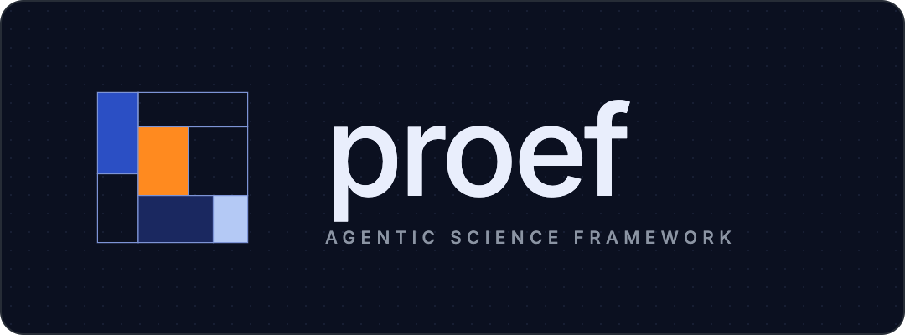
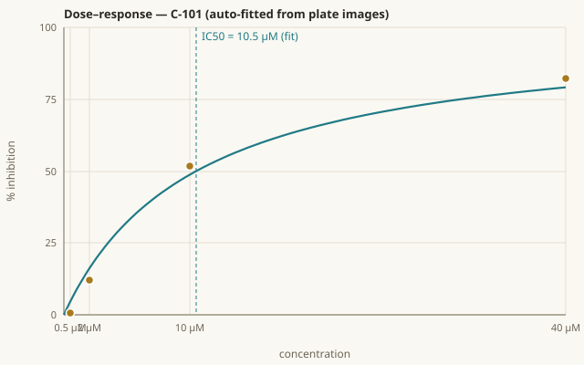
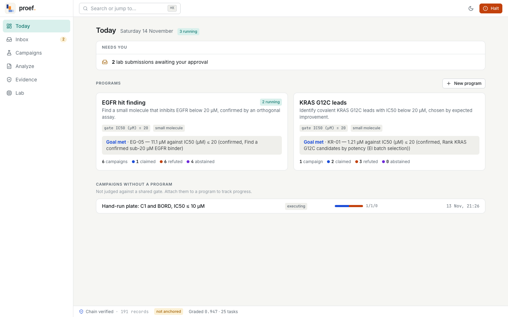
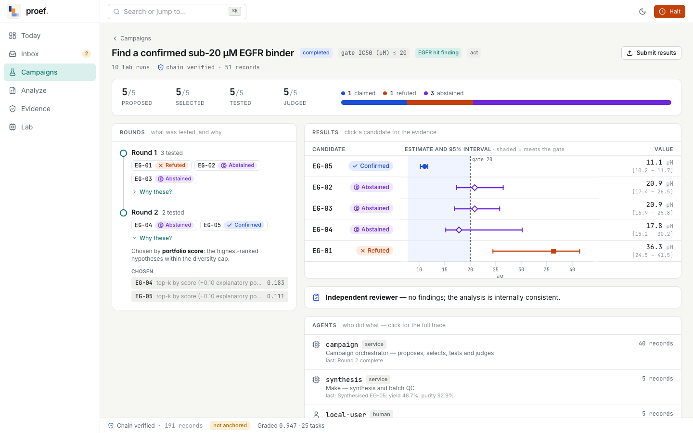
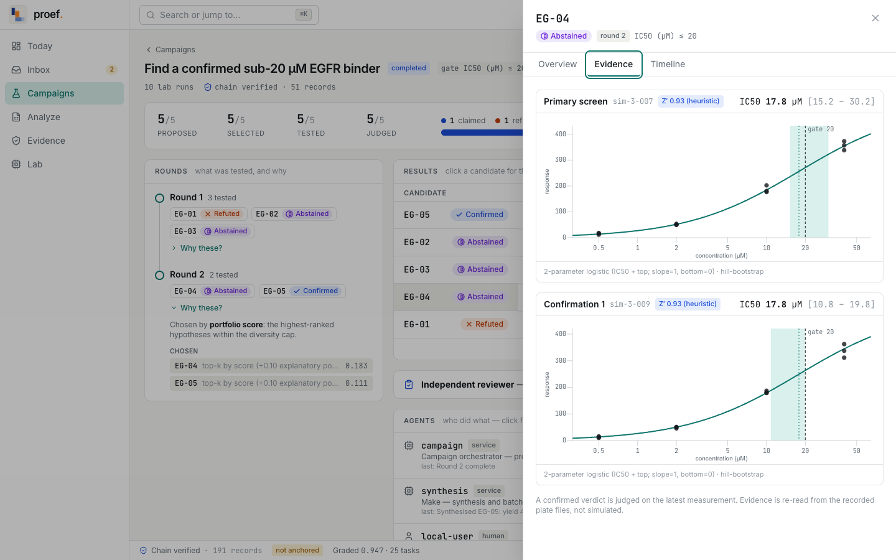
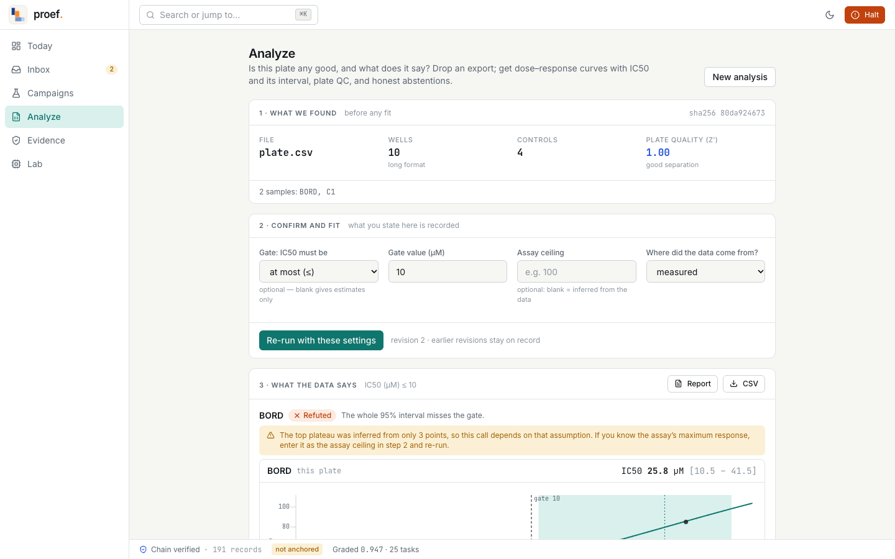
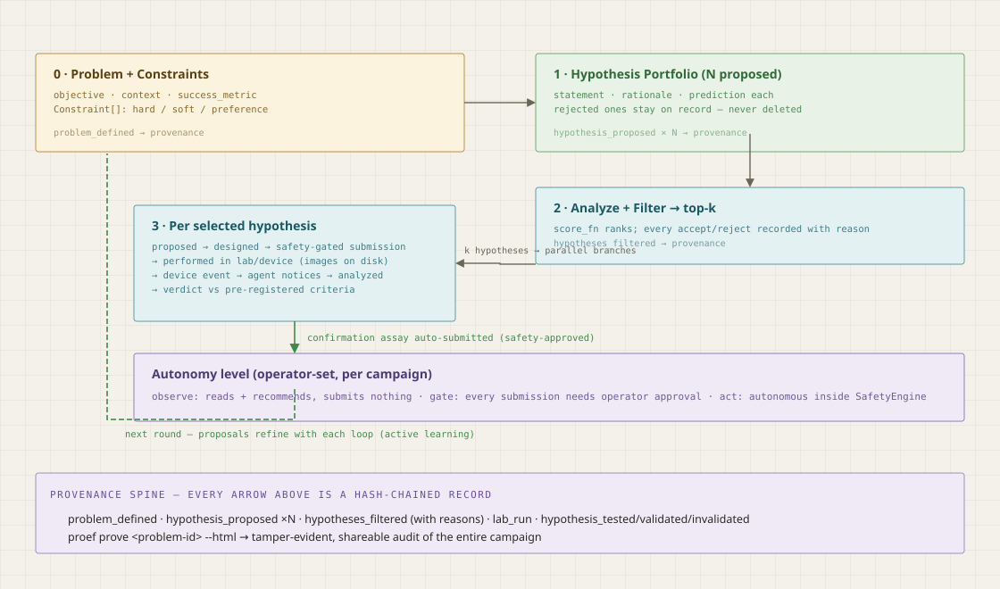

<p align="center">
  
</p>

[](https://github.com/rbalachandar/proef/actions/workflows/ci.yml)
[](https://pypi.org/project/proef/)
[](https://pypi.org/project/proef/)
[](LICENSE)

**The workbench.** Review what the agents did, see why a candidate abstained, run a plate yourself and have it judged
against the gate registered beforehand, and verify the ledger. *(Sample workspace on the simulated lab: the data is
simulated, not measured.)*


**The CLI.** The same engine from the terminal: `proef demo` runs the abstain-and-refute cascade. *(All numbers
simulated.)* Want to try the plate step yourself? Drop [`assets/demo/demo-plate.csv`](assets/demo/demo-plate.csv) into **Analyze**.


Proef is an open-source framework in which AI agents run the scientific
method end to end: given a research problem and its constraints, agents propose
a portfolio of hypotheses, select the ones worth testing, design experiments,
execute them on simulated or real laboratory equipment, observe the results as
they arrive, and deliver verdicts against criteria that were registered before
the experiment ran. A scientist can use it manually, step by step, as a daily
analysis tool — and hand stages of the loop to an agent as trust grows.

Proef is built on three principles:

- **Safety enforcement.** The only path from an agent to a lab is the
  gateway: every submission passes a policy engine the agent
  cannot modify or approve itself, and budgets cap what a campaign may
  consume. When experiments declare structures, those are screened against
  versioned toxicophore rules, so a declared covalent warhead can pass while
  an undeclared one does not. Campaigns that name a regulated pathogen or
  toxin are refused, and the refusal is recorded.
- **Tiered trust.** Deterministic rules hold the floor. A model may add a
  flag or demand a human review, but it can never clear a refusal. Humans
  settle the edge cases, and it is their judgment, not the model's
  confidence, that writes new rules. Citations are checked against PubMed: a
  hypothesis that cites a fake paper ranks below one that cites nothing.
- **Everything auditable.** The problem, the hypotheses, every decision,
  submission, result and verdict go into a hash-chained provenance store.
  One command renders the whole story as a report. Another seals it with a
  checksum you can publish somewhere you do not control, so anyone can check
  that the record has not been edited.

A campaign also chooses **which experiments to run**: each round's batch can
be selected by a deterministic, applicability-domain-gated **Bayesian
expected-improvement** acquisition (with an optional BoTorch/GP posterior),
scored against naive baselines in CI and sealed to provenance with its
reasoning.

**Contents:** [Installation](#installation) · [CLI](#cli) ·
[Evals](#evaluation-suite) ·
[Case studies](#case-studies) ·
[Using Proef](#using-proef) · [The virtual lab](#the-virtual-lab) ·
[Five core interfaces](#five-core-interfaces) · [Agent Skills and MCP](#agent-skills-and-mcp) ·
[Architecture](#architecture) · [Documentation](#documentation) ·
[Architectural principles](#architectural-principles) · [References](#references--sources)

## Installation

```sh
pip install proef                 # core (pydantic only) + the `proef` CLI
pip install "proef[api]"          # + the web workbench (FastAPI)
pip install "proef[dev]"          # + test dependencies
```

Optional extras: `[api]` (workbench) · `[bio-rdkit]` · `[lab-xlsx]` (read
`.xlsx` exports) · `[lab-imaging]` · `[models-openai]` · `[models-botorch]`
(GP posterior for acquisition) · `[mcp-instruments]` · `[sandbox-agentenv]` ·
`[sandbox-opensandbox]`.

From a checkout (this README tracks `main`; the published package may lag it):

```sh
make install       # python package + web deps into ./.venv
make test          # the offline test suite
make api           # workbench on :8000 (API + built SPA)
```

## CLI

Every capability is a `proef` command; the same functionality is available as a
Python API (see [Using Proef](#using-proef)).

```sh
# first run
proef demo                                # abstains on a borderline CI and refutes a
                                       # planted false hit (real machinery,
                                       # simulated numbers)

# analyze data
proef read results.csv --csv out.csv      # auto-analyze an instrument export
proef read plate.csv --layout map.csv \
        --normalize pct_inhibition     # join a plate map; %INH vs the plate's
                                       # own blank + full-inhibition controls
proef ingest legacy-eln.csv               # institutional memory: pre-Proef kills
                                       # enter ALREADY RULED OUT + family priors
proef connect scan <share>                # detect instruments writing into a folder
proef connect describe <device>           # interview you into an agent-readable device card
proef watch <outbox>                      # agent notices device outputs as they land

# run campaigns
proef templates                           # campaign presets — no JSON needed
proef campaign auto --template dose-response-screen --field compounds=C1,C2,C3
proef campaign auto campaign.json --dose-design adaptive   # Bayesian sequential dosing
                                       # (typically 3 wells, not 4)
proef campaign auto examples/campaign.json --acquisition bo-ei --dry-run
                                       # EI batch selection: shows the next batch +
                                       # every refusal (AD vetoes, diversity,
                                       # budget) — submits nothing
proef campaign select campaign.json       # the same what-would-run preview from a
                                       # config; no state written
proef campaign plan --objective "potent AND selective AND soluble" \
        --model anthropic --run-budget 20   # decompose into a guarded problem tree
proef campaign run examples/workflow.yml  # tournament + assay on the configured lab
proef campaign reproduce <branch>         # replay a recorded experiment, diff verdicts
make api                               # the web workbench on :8000 (API + SPA)

# audit and govern
proef diary <branch>                      # campaign as a lab-notebook narrative
proef prove <branch> --html out.html      # tamper-evident provenance + shareable report
proef prove <branch> --eln out.csv        # ELN-ready export (Benchling/SISSYO-friendly)
proef anchor [--publish-cmd CMD]          # Merkle-root the store; PUBLISH the root
                                       # (an unpublished anchor protects nothing)
proef anchor --verify                     # does the store still match the anchored root?
proef halt --engage --reason "spill"      # operator stop-condition outside the agent's reach
proef halt --clear                        # only a human clears it
proef sop list                            # agent-proposed recurring procedures awaiting sign-off
proef sop approve <sop-id> --by "lab lead"  # sign-off turns a procedure into standing policy
proef why char-ridge train.csv CCCCCO     # attribution panel: per-prediction drivers,
                                       # caveats + applicability domain

# measure and extend
proef eval --all                          # scored task suite + leaderboard
proef eval --suite epistemics,models      # run tiers separately
proef fixtures verify <study-dir>         # byte-reproducible case-study data
proef mcp                                 # MCP server: drive Proef from Claude/Cursor
proef new-adapter lab my_robot            # scaffold a tested LabAdapter
proef skills list                         # discovered Agent Skills (theirs and ours)
```

## Case studies

Eight studies run the flow on real data. Some results are negative, and they
are reported as such. Each study's README has the setup, full results and
limitations.

| Study | What it tests | Result |
|---|---|---|
| [01](case-studies/01-egfr-blind-reproduction/) · Tyrphostins (1989) | Blind reproduction of a classic paper | **Illustrative only:** the model had already seen the paper. |
| [02](case-studies/02-az3246-hpk1/) · AZ3246 HPK1 (2025) | Blind hypothesis and potency ranking on a post-cutoff paper | Found the paper's core from structures alone. Ranking is above chance (ρ ≈ +0.5 over 5 runs) but **not significantly better than simple baselines** at n = 21. |
| [03](case-studies/03-multi-paper/) · Four ChEMBL papers | Does the full flow run on real data? | Chemotype identified 4/4; flow and audit trail intact; **no enrichment claim survives correction**. |
| [04](case-studies/04-prospective-hit2lead/) · EGFR hit-to-lead | A prospective loop on replayed real data, seven successor drugs hidden | 5 hits (all true), 5 refutations (all true), 2 honest abstentions. |
| [05](case-studies/05-paper-pilot/) · SARS-CoV 3CLpro screen (2013) | Reproduce a published screening cascade from raw tables | 98.9% agreement on decided calls, 0 false actives, 14 abstentions. |
| [06](case-studies/06-ncats-deposit/) · NCATS qHTS | Re-analyze a modern deposited screen | **Negative:** our rules don't port to self-normalized data (ρ = 0.107), which led to refusing them. |
| [07](case-studies/07-proteinbase/) · Proteinbase | Reproduce a protein-design dataset | Hit rates reproduced. Computed confidence picks *worse* than random. A miscalibrated applicability-domain floor was fixed. |
| [08](case-studies/08-proteinbase-entry/) · PD-L1 binder designs | Does a score separate designs from controls? | Separates the groups (AUC 0.80) but **doesn't rank sequences**: use it as a gate, not a ranking. |

## Evaluation suite

`proef eval` runs scored tasks against seeded ground truth — deterministic,
offline, and run in CI. A score below 1.0 is kept as reported: an honest
abstention is graded down, not counted as a pass. The latest full run is 25
tasks, mean 0.947, all passing ([`evals/leaderboard.md`](evals/leaderboard.md));
CI fails if any score drops below the pass bar.

| Tier | Covers | Examples |
|---|---|---|
| **epistemics** (15) | reasoning under uncertainty | hit recovery vs truth · verdict honesty (abstain where the CI straddles the gate) · confirmation coverage · falsifiability · adaptive dosing · EI acquisition (must honour the applicability-domain gate) · flywheel memory |
| **models** (6) | baseline model quality | Lipophilicity, ESOL, HIV, Caco2, HIA, BBB on scaffold folds, frozen in-repo, against a random floor |
| **reproductions** (2) | published-paper reruns | frozen data fixtures |
| **agent** (2, opt-in) | end-to-end triage | workflows with one verifiable answer — exact refusal map, no refused compound tested, no wrong confirm, byte-exact reruns; graded deterministically, no LLM judge (`proef eval --suite agent`) |

```
epistemics — mean 0.969 · 15/15 tasks pass
  hit-recovery         0.833  honest abstains credited 0.5, not 1.0
  acquisition-policy   0.875  EI batch beats gates+randomize on every pool
  adaptive-dose        0.875  3 wells beat 4 — a genuine negative result
  verdict-honesty      1.000  must abstain where the CI straddles the gate
```

The suite has caught real bugs: an observed-max fit bias, confirmation labels
that overrode the gate, and a Make step that ran before the safety screen.
Each one is now a permanent regression test. `GET /api/v1/evals` serves the scores
and flags every passing task below 1.0 as an `honest_deduction`; the workbench
header shows the live `graded 0.947 · 25 tasks, all pass` badge.

### Trust mechanisms

These are modality-agnostic: the loop, the gates and the record work the same
for a kinase IC50, a plate-reader export or a protein binder's predicted
confidence. The full table (two dozen rows) is in
[docs/safety-and-security.md](docs/safety-and-security.md).

| Mechanism | What it guarantees |
|---|---|
| Uncertainty vetoes certainty | a 95% CI straddling the gate abstains, on any metric |
| Pre-registered claims | every hypothesis records its predicted and **refuted-if** clauses before data arrives |
| Molecular safety gate | 18 curated toxicophore rules (versioned); hard classes always refuse; electrophilic warheads pass only with declared covalent intent |
| Execution governance | enforced in gateway code, outside the agent: an operator halt it cannot lift (`proef halt`), an autonomous / human-approved / never authorization matrix, SOP sign-off for anything recurring |
| Provenance physics | the hash chain is engine-enforced and recomputed on read; verdict reading is payload-driven, recency-wins |
| Physical-fault honesty | saturated plates, dark reads and device errors are flagged for inspection, never retried blindly or turned into verdicts |
| Input trust boundary | junk or adversarial instrument files degrade to "unreadable, no verdicts changed"; injection-shaped sample names cannot reach the gate as instructions |

## Using Proef

Proef supports two working styles on the same engine: use it by hand as a
daily analysis tool, or hand stages of the loop to an agent as trust grows. The
loop is **modality-agnostic**: the program defines the objective in your own
terms (any metric, unit, direction), Make words production per modality,
adapters supply the assay, and Analyze reads the registered metric against its
gate.

### Analyze an instrument export yourself

`proef read` auto-detects long CSV/TSV/XLSX tables, plate grids, kinetic tables
(Tecan, BioTek) and `.npy` images. IC50 fits carry confidence intervals; Z′ is
computed only when the plate has both control classes (otherwise it is reported
as the `Z'~` heuristic); reader, serial and date are kept for provenance.

```sh
proef campaign auto examples/campaign.json         # a campaign drops an export per run
proef read .data/inbox/<problem-id>/sim-42-001.csv
# plate: sim-42-001.csv [long] | wells: 14 | controls: 2 | Z'~ 0.959 (control-spread heuristic)
# compound        IC50 (uM)  points  note
# C-103                5.30      12  observed-max

proef read tests/data/instruments/biotek_1steptimer.csv
# plate: biotek_1steptimer.csv [kinetic] | wells: 1536 | ... | reader: Synergy HTX (2206293D)
# (a bare grid: no compound identity, no concentration series — reported as such)

proef read tests/data/instruments/tecan_ON1.csv --layout tests/data/instruments/plate_layout_96.csv
# plate: tecan_ON1.csv [kinetic] | wells: 192 | ... | edge-effect -0.0 (OD600:600)
# joins well -> sample/concentration from the plate map, fits what it can

proef read tests/data/instruments/tecan_ON1.csv --normalize pct_inhibition
# proef: error: cannot normalize to %inhibition: need >=2 blank AND >=2
# full-inhibition control wells — raw values kept
# (the refusal path: this plate has no control-class wells)
```

`--layout` joins a plate map to exports that carry no compound identity;
`--normalize pct_inhibition` rescales against the plate's own controls and
refuses when those are missing. Three genuine vendor exports ship in
`tests/data/instruments/` so you can try the parser on real output first.

```python
from proef.labread import read_plate
r = read_plate("my_results.csv")   # long/grid/xlsx/imaging evidence
print(r)                           # IC50 table + Z' — no configuration
svg = r.curve_svg("C-101")         # fitted dose–response curve
```



### Try the virtual lab

```sh
proef demo                                   # guided first run: abstains on a borderline CI, refutes a planted false hit
python examples/demo_full_flow.py         # one round, end to end: tournament → safety gate → virtual lab → analysis → provenance
```

### Hand the full campaign to the agent

```sh
proef templates                              # list presets
proef campaign auto --template dose-response-screen --field compounds=C1,C2,C3
proef campaign auto campaign.json            # or your own config
```

<details><summary>campaign.json — an example problem statement</summary>

```json
{
  "problem": {
    "objective": "Find a confirmed sub-20uM KRAS_G12C binder",
    "constraints": [
      {"name": "potency", "description": "IC50 <= 20 uM", "kind": "hard",
       "limit": 20.0, "unit": "uM"}
    ],
    "success_metric": "orthogonal confirmation"
  },
  "hypotheses": [
    {"statement": "C-101 binds with IC50 <= 20 uM", "candidate": "C-101",
     "assay_type": "binding", "predicted": "IC50 <= 20",
     "predicted_value": 20.0, "rationale": "covalent warhead precedent"}
  ],
  "autonomy": "act"
}
```
</details>

```
[22:31:41] lab: 'proef-virtual-lab-0' selected from a pool of 1 (simulated=True); decision sealed
[22:31:41] round 1: testing ['C-103', 'C-101'] (1 candidates remain)
[22:31:41] started lab run sim-42-001 for C-103 on simulator (4 doses × 3 replicates)
[22:31:42] [agent] reading instrument output sim-42-001.csv (device finished the measurement)
[22:31:42] [agent] hypothesis hyp-92fa273f (C-103): VALIDATED (preliminary — pending orthogonal confirmation) — IC50 5.296 uM (95% CI 3.382–6.541) vs threshold 20.0
[22:31:42] [agent] sending orthogonal confirmation assay for C-103 (safety-approved) -> run sim-42-003
[22:31:44] [agent] orthogonal confirmation for C-103: primary 5.30 vs secondary 6.37 µM (ratio 1.2x, rule ci-overlap) -> CONFIRMED
[22:31:44] reviewer: no findings — analysis consistent
[22:31:44] CAMPAIGN COMPLETE prob-fe6dcecd: C-103=confirmed, C-101=confirmed
{"problem": "prob-fe6dcecd", "selected": ["C-103", "C-101"],
 "verdicts": {"C-103": "confirmed", "C-101": "confirmed"}}
```

Abridged output of `proef campaign auto examples/campaign.json`; the simulator is seeded, so reruns reproduce these numbers.

### Let the agent watch your instruments

With `proef watch` on an instrument outbox, no files get shuttled: when a reader
exports a result the agent reads it, updates open hypotheses against their
pre-registered criteria, and recommends the next step. `proef connect scan` finds
which instrument writes into a folder.

```sh
proef connect scan tests/data/instruments
# scanned 6 files in tests/data/instruments
#   kinetic x3   e.g. biotek_1steptimer.csv
#   grid   x1   e.g. plate_layout_96.csv
#   xlsx   x1   e.g. tecan_ON1.xlsx
#   → device: plate reader (auto-exporting to this share)
```

### Declare your instrument fence

The program creator declares a **pool of permitted instruments** (`labs:` in the
campaign config, by id from `proef/instruments.json` or as inline
adapter/MCP entries). The matcher then picks **within** that pool from each
experiment's declared needs (assay types, readouts, BSL ceiling), preferring
hardware-validated over simulated. Under gate autonomy a real choice between
instruments is confirmed by a human. The choice, and why each other instrument
was declined, is sealed into the branch before anything runs; with no capable
instrument the campaign refuses rather than falling back to simulation
(`proef.labselect`).

### Configure agent authority and limits

| autonomy | agent behavior |
|---|---|
| `observe` | reads, fits, recommends — submits nothing |
| `gate` | proposes everything; each lab submission waits for your Approve click in the workbench |
| `act` | autonomous within the SafetyEngine, including confirmation assays |

- **Round breadth** is schedulable: `"k": [4, 2, 1]` screens wide first, then narrows as the flywheel discounts failed families.
- **Verdicts are uncertainty-aware:** a fitted IC50 whose 95% CI straddles the threshold is `inconclusive`. An orthogonal confirmation verifies the *direction* of the preliminary verdict: agreement confirms hits and refutes non-hits; disagreement on a claimed hit refutes it.
- **Adaptive dosing** (`--dose-design adaptive`) lets a Bayesian posterior pick each next concentration (3 adaptive wells beat a fixed 4-point series in `proef eval`).
- **A `ResourceBudget`** (lab runs, hypotheses, confirmations, wall clock) is enforced at submission and generation time. `proef prove <problem-id> --html report.html` renders the whole chain as a shareable audit.

### The scientist's workbench

| Today: programs against their gates | A campaign: estimates and 95% intervals against the gate |
|---|---|
|  |  |
| **The evidence behind one verdict** | **Analyze: drop a plate, read the curves** |
|  |  |

*Screenshots are from the sample workspace, which runs on the simulated lab: the data is simulated, not measured.*

`make api` serves the web workbench (React + FastAPI), all local, no accounts, no cloud:

- **Today:** what needs you, and each program's progress against its pre-registered gate.
- **Decisions:** approve or decline gated lab submissions, and review abstentions (follow up, accept as inconclusive, or drop). Every decision is sealed in the ledger under your name.
- **Campaign cockpit:** every estimate drawn with its 95% interval against the gate, why each batch was chosen (and what was refused), who did what (agents and people, with full traces), and an independent reviewer. A candidate whose interval straddles the gate is shown as **abstained**, never as a coin-flip verdict.
- **Evidence behind a verdict:** the recorded dose–response curves re-read from the run files, the plate's QC, and how the number was derived.
- **Analyze:** drop a plate-reader export and get curves with IC50 and its interval, plate QC, and honest abstentions. It warns when a call rests on an inferred top plateau. Record your decision beside the computed call, and attach the analysis to a campaign as supporting evidence.
- **Run it yourself:** start a hand-run campaign, whose gate is registered on each candidate before any data. Run the plate, then **Submit results**: the CSV is judged by those pre-registered criteria, and the submission is sealed before anything is judged.
- **Evidence and Lab:** verify the whole ledger, anchor it outside this machine, and export a campaign's record. Instruments are labelled simulated, real, or hardware-validated, and the page shows what agents may do alone, what needs a person, the SOP sign-offs and the stop switch.
- **Try it:** `proef demo` runs the abstain-and-refute cascade; `make sample` seeds a sample workspace.

Also: `proef diary <branch>` writes the record as a static lab-notebook HTML file, and `proef read --csv out.csv` writes standardized results for Excel/GraphPad.

### The DMTA cycle — scientific decision layer

Proef models Design–Make–Test–Analyze as first-class objects:

- **Target Product Profile** — the program defines winning in your own terms (objective, metric, unit, direction, gate); small-molecule programs can add phased criteria (hit → lead → candidate → clinical) in `proef.tpp`.
- **Experiment Definition** — the full manifest: intervention, biological system, readout capabilities, denominators, expected intermediates.
- **Readiness Review** — runs *before* the safety gate and can block an experiment that would be unsafe to *interpret* (missing denominator, mimetic vs authentic modification, unmeasured delivery variance).
- **Program hierarchy** — Program ▸ Problem ▸ Hypothesis ▸ Experiment, with the gate inherited downward.
- **Flywheel** — every verdict is remembered: failing mechanistic families are discounted later and the hypothesis agent is shown what the lab already ruled out.

External database adapters: ChEMBL, Open Targets, PubMed. Benchmark datasets: MoleculeNet, TDC, DOCKSTRING ([`docs/benchmarks.md`](docs/benchmarks.md)).

### How a campaign runs — who acts, and what Proef enforces

When you run `proef campaign auto`, here is what happens to one compound, step by
step, and which layer is responsible at each point:

| Step | Who acts | What happens | What Proef enforces |
|---|---|---|---|
| 1. Problem setup | **Problem definition** | Decomposes the objective into constraints | Records problem + constraints as the provenance root |
| 2. Hypothesis proposal | **Hypothesis agent** using the `rdkit` **skill** | Generates analogs with SAR rationale | Validates schema, dedupes, records rationale; injects skill guidance |
| 3. Portfolio filter | **Portfolio selector** | Scores + ranks, applies diversity cap | Records every accept/reject with reason |
| 4. Readiness review | **ExperimentDefinition** | Checks: is the readout capable? denominator present? synthesis feasible? | **Blocks** if the result would be uninterpretable |
| 5. Safety gate | **SafetyEngine** | Checks reagents, BSL, step count, **toxicophores in sample structures**, dual-use text | **Refuses** with machine-readable reason + rule-set version |
| 5b. Governance gate | **HaltSwitch + AuthorizationMatrix + SOP registry** — code the agent cannot reach | Checks the operator halt, the autonomous/human/never column, and SOP sign-off for recurring work | Refuses outside the agent's reach; every decision recorded as provenance |
| 6. Lab execution | **LabAdapter** (simulator, Opentrons, PlateReaderShare) | Runs the assay, produces raw evidence | Records run ID, parameters, and raw output |
| 7. Device event | **DeviceMonitor** | Notices the export appeared | Triggers agent analysis automatically |
| 8. Analysis | **Analysis agent** + `labread` | Fits IC50s, checks QC, flags artifacts | Records measurements + QC flags as provenance |
| 9. Verdict | **Analysis** against pre-registered criteria | VALIDATED / INVALIDATED / INCONCLUSIVE — a CI straddling the gate or a QC failure abstains | Records the verdict with evidence, criteria and confidence interval |
| 10. Audit | **ProvenanceStore** | Renders the full chain | `proef prove` verifies the hash chain; `proef anchor` makes it externally checkable |

**Division of labor.** The intelligence comes from the models: the LLM derives
the SAR hypothesis, the QSAR model makes the calibrated prediction. Proef
is the layer that makes those results executable, bounded, measurable and
auditable. Skills teach the agent *how* (domain knowledge from Scientific Agent
Skills or the `proef` skill); tools let it *act* (`run_assay`,
`propose_hypothesis`, via MCP or direct Python); the gates decide *whether*
(SafetyEngine, governance, readiness review); provenance records *what
happened*. Each layer is independently swappable, but they only produce
trustworthy science when composed through the Proef flow.

Four things cut across the steps rather than sitting in one:

- **Contamination control** — post-cutoff and never-published-variant probes
  run and are recorded, so a "no prior knowledge" claim is part of the audit
  trail.
- **Memory** — the flywheel discounts failed mechanistic families in every
  later portfolio, and the hypothesis agent is told what the lab already
  ruled out.
- **Accountability** — hash-chained provenance plus Merkle anchoring.
- **Measurement** — `proef eval`: a scored, deterministic task suite in CI (see
  [Evaluation suite](#evaluation-suite)).

## The virtual lab

Simulated devices at three fidelity tiers let the whole loop run offline, so
every layer is testable before hardware is involved:

- **Assay simulators** — seeded dose–response truth, replicates, interference artifacts, controls; plus DLS, ELISA, DSF, imaging, synthesis and bioprocess simulators, round-trip tested against the analysis adapters.
- **Wire-level device simulators** — instrument protocols simulated from the manufacturer's published contract, with teeth: `ot2_sim` refuses header-less clients and wrong multipart fields; the EZO pH simulator reproduces datasheet quirks, and its calibration uncertainty flows into verdicts.
- **Recording/playback** — real hardware sessions are recorded once and replay identically in CI.
- **MCP practice mode** — external instrument servers run under `--simulate`, driven by the same adapter that will drive the hardware.

Every simulator labels itself in its capabilities, and adapters whose live
mode doesn't exist refuse rather than serve synthetic readings as instrument
data. See [`docs/virtual-lab.md`](docs/virtual-lab.md).

## Five core interfaces

Everything implements one of five interfaces; adapters are opt-in and
interchangeable. The contracts are the pydantic models in `proef.core.contracts`.

| Interface | Adapters today |
|---|---|
| `ModelProvider` | OpenAI-compatible (OpenAI, ollama, vLLM), Anthropic |
| `LabAdapter` (+ `SafetyEngine`, `LabGateway`) | simulators, imaging, recording/replay, PlateReaderShare, Opentrons OT-2/Flex (contract-tested against a simulated robot; hardware confirmation pending). LC-MS and HCS are simulator-only; the SiLA 2 and scheduler adapters are generic-HTTP templates |
| `Sandbox` | local, Docker, OpenSandbox, AgentENV |
| `ProvenanceStore` | SQLite (Postgres and S3-WORM on the roadmap) |
| `BioTool` | RDKit descriptors, ADMET, AlphaGenome variant scoring |

Sandboxing is opt-in (`sandbox: {mode: per_experiment, type: local|docker}`):
lab calls and tool calls run in one sandbox per experiment, every op is
provenance-sealed, and the experiment page shows a receipt. Docker mode uses
`Dockerfile.sandbox` with egress closed by default, verified in CI. Analysis
fits and the agent/reviewer/MCP registry lanes still run in-process (S-T3 1d/1e
in [`docs/ROADMAP.md`](docs/ROADMAP.md)).

## Agent Skills and MCP

Proef ships as an [Agent Skills](https://agentskills.io/) package
(`skills/`, `plugin.json`) and exposes its tools over MCP:

```json
{"proef": {"command": "proef", "args": ["mcp"]}}
```

It also *consumes* MCP instrument servers through `McpLabAdapter`: typed tool
schemas, read-only auto-invocation, everything gated. It was tested live
against two [K-Dense LabMCP](https://github.com/K-Dense-AI/lab-instrument-mcps)
servers (a Mettler Toledo balance and an IKA hotplate); nothing is
hardware-validated yet.

It composes with [Scientific Agent Skills](https://github.com/K-Dense-AI/scientific-agent-skills):
those teach an agent *how* to author protocols and query databases; Proef
decides *whether they run* and records what happened. Skills shipped here:
`proef` · `proef-labread` · `proef-labwatch` · `proef-campaign` · `proef-opentrons`.

## Architecture

Engine architecture, blocks A–F: [`docs/architecture.md`](docs/architecture.md),
[`docs/flows.md`](docs/flows.md), [`docs/blocks/`](docs/blocks/). Styled HTML
versions of all diagrams are in [`diagrams/artifacts/`](diagrams/artifacts/).

**Layered view** — governance at the top, infrastructure at the bottom, the five blocks between.


**Problem → portfolio → autonomous loop** — state the problem, propose N hypotheses, filter to k, test and confirm autonomously, with the provenance spine.



More: [design iteration loop](diagrams/svg/02-iteration-loop.svg) ·
[hypothesis tournament](diagrams/svg/03-tournament.svg) ·
[wet-lab round trip](diagrams/svg/04-wetlab-roundtrip.svg) ·
[fork / snapshot branching](diagrams/svg/05-branching.svg) ·
[campaign pipeline](diagrams/svg/06-campaign.svg) ·
[scientific decision layer](diagrams/svg/08-scientific-decision-layer.svg).

## Documentation

| Doc | Contents |
|---|---|
| [`docs/QUICKSTART.md`](docs/QUICKSTART.md) | install, scientist path, workflows, campaign commands |
| [`docs/ADAPTERS.md`](docs/ADAPTERS.md) | authoring adapters (labs, models, tools, stores) |
| [`docs/safety-and-security.md`](docs/safety-and-security.md) | full mechanism table, safety rules, trust boundaries, threat model, API access |
| [`docs/virtual-lab.md`](docs/virtual-lab.md) | simulated devices, image-based readouts, QC and failure modes |
| [`docs/benchmarks.md`](docs/benchmarks.md) | public datasets and benchmark results |
| [`docs/domain-review.md`](docs/domain-review.md) | flow fidelity review vs. the real drug-discovery cycle |
| [`docs/stability.md`](docs/stability.md) | versioning, stability tiers, deprecation policy |
| [`docs/research-landscape.md`](docs/research-landscape.md) | review vs. Google, Anthropic, Isomorphic, Cradle, Lila, FutureHouse, OpenAI Rosalind |
| [`docs/critical-review.md`](docs/critical-review.md) · [`docs/REVIEW-2026-10.md`](docs/REVIEW-2026-10.md) | independent critical reviews: strengths and failure modes |
| [`docs/UX.md`](docs/UX.md) · [`docs/BRAND.md`](docs/BRAND.md) | workbench UX principles and brand system |
| [`docs/PLAN.md`](docs/PLAN.md) | build plan, principles, guardrails |
| [`docs/ROADMAP.md`](docs/ROADMAP.md) | the live plan: open work, status boxes, remediation log |
| [`docs/architecture.md`](docs/architecture.md) · [`docs/flows.md`](docs/flows.md) · [`docs/blocks/`](docs/blocks/) | architectural blocks A–F, components, interfaces, end-to-end flows |
| [`case-studies/`](case-studies/) | blind reproduction studies on real published data |
| [`diagrams/`](diagrams/) | SVG diagrams + styled HTML artifact pages |

## Architectural principles

1. **Contract-first integration** — blocks communicate only through five versioned
   schemas; nothing else couples them.
2. **Hardware behind an abstraction** — agents see the Instrument Abstraction Layer
   (IAL) only; a Virtual Lab Simulator is a drop-in stand-in for real robots.
3. **State is snapshot-able** — every experiment branch runs in a sandbox that can be
   forked, paused at review gates, and replayed for audits.
4. **Provenance is immutable** — every artifact carries full lineage (inputs, model
   versions, prompts, instrument run IDs) in WORM storage.
5. **Safety is non-bypassable** — a policy engine sits in the physical-action path,
   outside any agent's trust boundary.
6. **Claims are measured** — every capability claim has a scored eval task behind
   it; uncertainty is reported, not rounded away.
7. **AI can only tighten the gate** — deterministic rules hold the safety floor,
   model judgment may add flags or demand review but never clear a refusal,
   and humans — not the model — promote adjudications into rules.

## Contributing

Start with [`docs/ADAPTERS.md`](docs/ADAPTERS.md) and
`proef new-adapter` — every adapter scaffold is born with a passing test.
Interface changes go through an ADR; see
[`docs/stability.md`](docs/stability.md). Apache-2.0.

## References & Sources

The architecture draws on published work from teams operating in this space. The
full review — what each system does, how it compares, and which learnings were
folded into this design — is in [`docs/research-landscape.md`](docs/research-landscape.md).

**Key sources:**

- Google — [AI co-scientist](https://research.google/blog/accelerating-scientific-breakthroughs-with-an-ai-co-scientist/) ([paper](https://arxiv.org/abs/2502.18864)) · [AlphaFold 3](https://www.nature.com/articles/s41586-024-07487-w) · [Isomorphic Labs Drug Design Engine](https://www.isomorphiclabs.com/articles/the-isomorphic-labs-drug-design-engine-unlocks-a-new-frontier) · [Bioresilience approach](https://www.isomorphiclabs.com/articles/our-approach-to-bioresilience)
- Anthropic — [Claude for Life Sciences](https://www.anthropic.com/news/claude-for-life-sciences) · [Model Hardware Standard](https://www.anthropic.com/news/model-hardware-standard-research-preview)
- Cradle Bio — [Platform](https://www.cradle.bio/platform) · [Series B / wet-lab expansion](https://techcrunch.com/2024/11/26/cradle-builds-out-its-protein-design-ai-platform-and-wet-lab-with-73m-in-new-funding/)
- FutureHouse — [Robin multi-agent system](https://www.futurehouse.org/research-announcements)
- Lila Sciences — [Agent-driven science on NVIDIA BioNeMo](https://www.lilasciences.com/news/building-the-agent-driven-era-of-science-with-nvidia-bionemo-agent-toolkit)
- Helical — [Virtual AI lab / Helix-mRNA FM](https://www.helical.bio/)
- Coscientist (CMU) — [Autonomous chemical research with LLMs + robotics, Nature 2023](https://www.nature.com/articles/s41586-023-06792-0)
- OpenAI + Retro Biosciences — [GPT-4b micro protein engineering, MIT Tech Review](https://www.technologyreview.com/2024/12/09/1108188/openai-model-for-protein-engineering-gpt-4b-micro-retro-biosciences/)
- Chai Discovery — [chai-1/chai-2 structure & antibody models](https://www.chaidiscovery.com/)
- OpenSandbox — [production sandbox runtime](https://github.com/opensandbox-group/OpenSandbox) — supported Sandbox adapter target (gVisor/Kata/Firecracker, egress control, K8s)
- Scientific Agent Skills (K-Dense) — [163 validated scientific agent skills](https://github.com/K-Dense-AI/scientific-agent-skills) — complementary knowledge layer; Proef tools are exposed via MCP and the Agent Skills standard · [LabMCP](https://github.com/K-Dense-AI/lab-instrument-mcps) — 32 lab-instrument MCP servers (Opentrons, SiLA 2, balances, pumps, spectrometers…) each manual-derived with a simulator for every instrument and a community hardware-verification program; the candidate device-transport layer for ROADMAP S-T4 (Proef keeps governance; per-instrument manuals stay upstream)
- OpenAI — [GPT-Rosalind & Rosalind Workbench](https://openai.com/gpt-rosalind/) ([announcement](https://developers.openai.com/blog/rosalind-workbench)) — closed vertical competitor; see [positioning analysis](docs/research-landscape.md#rosalind-what-it-changes-and-where-proef-stands)
