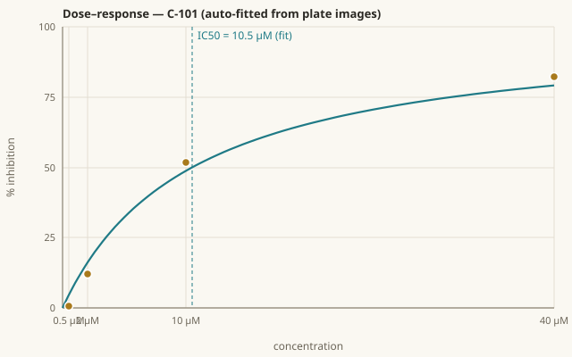
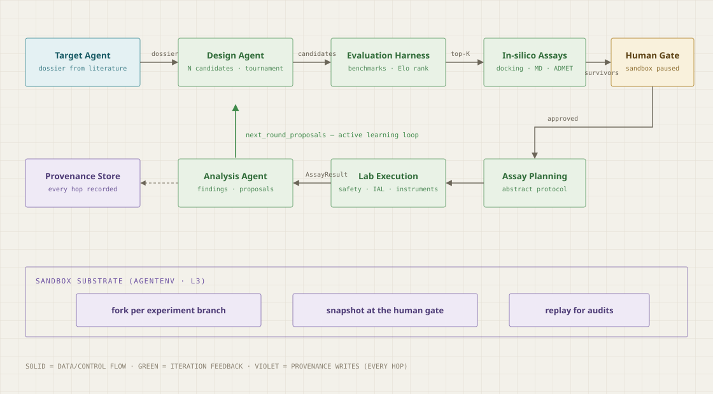
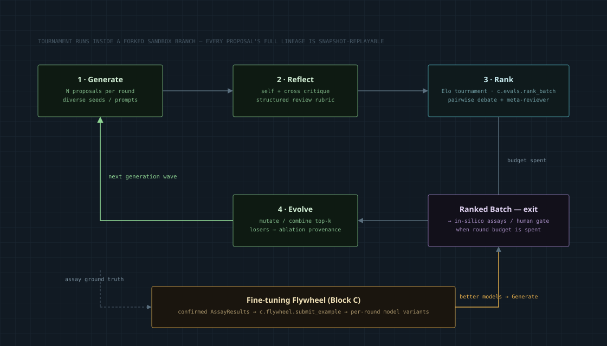
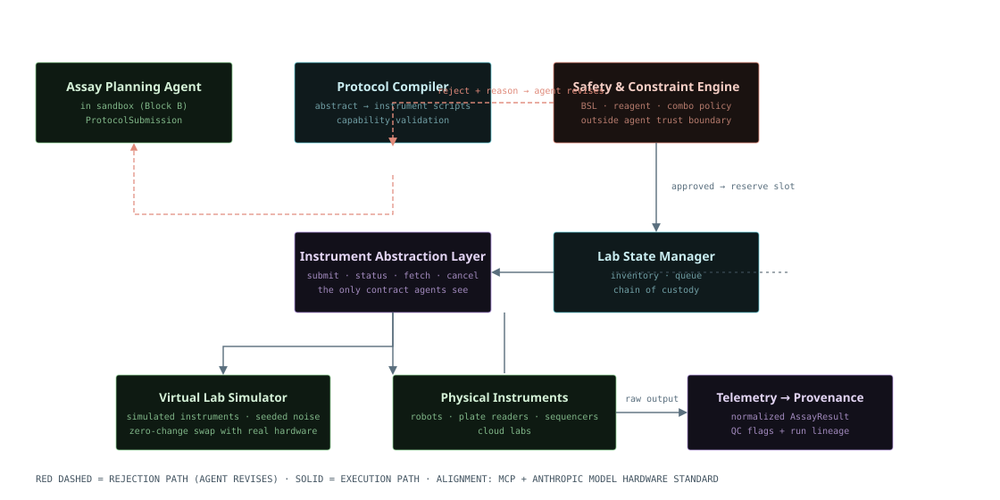
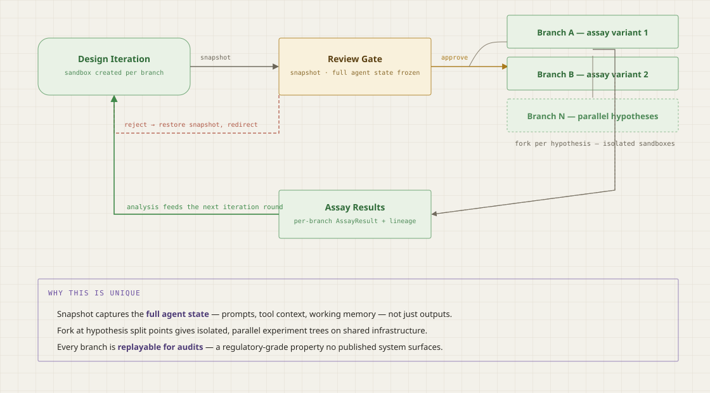
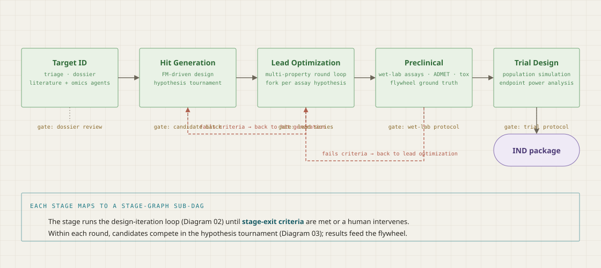
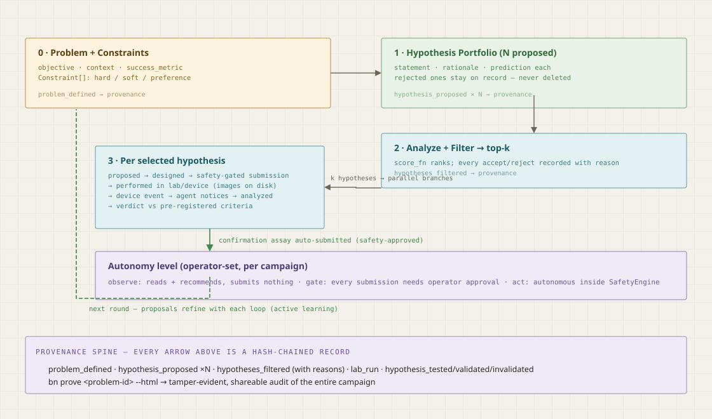
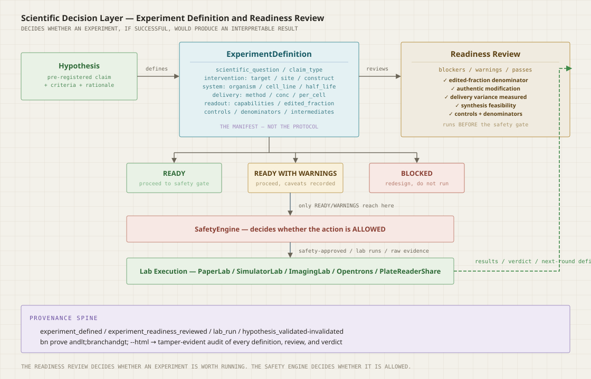

# BioNexus

[](https://github.com/rbalachandar/bionexus/actions/workflows/ci.yml)
[](https://pypi.org/project/bionexuslab/)
[](https://pypi.org/project/bionexuslab/)
[](LICENSE)

BioNexus is an open-source framework in which AI agents run the scientific
method end to end: given a research problem and its constraints, agents propose
a portfolio of hypotheses, select the ones worth testing, design experiments,
execute them on simulated or real laboratory equipment, observe the results as
they arrive, and deliver verdicts against criteria that were registered before
the experiment ran.

Two properties make it suitable for real laboratory work rather than
demonstrations:

- **Safety is structural, and it looks at molecules.** Agents never address
  instruments directly: every physical action passes a policy engine outside
  the agent's trust boundary, budgets cap consumption — and the gate screens
  *structures* (versioned toxicophore rules, intent-aware) and *targets*
  (dual-use/DURC refusal), not just paperwork.
- **Trust is tiered, and the tiers are asymmetric.** Deterministic rules hold
  the floor; AI may only tighten a gate, never loosen one; humans adjudicate,
  and their decisions — not the model's — promote new rules. Every citation a
  hypothesis leans on is verified against PubMed; a fabricated reference ranks
  worse than none.
- **Every step is auditable.** Problem, hypotheses, decisions, submissions,
  results, and verdicts are recorded in a hash-chained, tamper-evident
  provenance store that renders as a shareable report.

**Contents:** [Installation](#installation) · [CLI](#cli) ·
[Case studies](#bionexus-case-studies-on-published-papers) ·
[Using BioNexus](#using-bionexus) · [The virtual lab](#the-virtual-lab) ·
[Five core interfaces](#five-core-interfaces) · [Agent Skills and MCP](#agent-skills-and-mcp) ·
[Architecture](#architecture) · [Documentation](#documentation) ·
[Design principles](#design-principles) · [References](#references--sources)

## Installation

```sh
pip install bionexuslab                 # core (pydantic only) + CLI
pip install "bionexuslab[dev]"          # + development dependencies
```

Optional extras: `[models-openai]` · `[bio-rdkit]` · `[lab-imaging]` ·
`[sandbox-agentenv]` · `[sandbox-opensandbox]` · `[store-postgres]`.

## CLI

Every capability is a `bn` command; the same functionality is available as a
Python API (see [Using BioNexus](#using-bionexus)).

```sh
bn read results.csv --csv out.csv      # auto-analyze an instrument export
bn connect scan <share>                # detect instruments writing into a folder
bn watch <outbox>                      # agent notices device outputs as they land
bn templates                           # campaign presets — no JSON needed
bn auto --template dose-response-screen --field compounds=C1,C2,C3
bn serve                               # headless cockpit (or: streamlit run Overview.py)
bn diary <branch>                      # campaign as a lab-notebook narrative
bn prove <branch> --html out.html      # tamper-evident provenance + shareable report
bn prove <branch> --eln out.csv        # ELN-ready export (Benchling/SISSYO-friendly)
bn anchor [--publish-cmd CMD]          # Merkle-root the store; publish the root
bn reproduce <branch>                  # replay a recorded experiment, diff verdicts
bn sim                                 # reference design round on the virtual lab
bn run examples/workflow.yml           # tournament + assay on the configured lab
bn mcp                                 # MCP server: drive BioNexus from Claude/Cursor
bn new-adapter lab my_robot            # scaffold a tested LabAdapter
bn skills list                         # discovered Agent Skills (theirs and ours)
bn eval --all                          # the measurable claim: scored task suite + leaderboard
bn eval --suite epistemics,models      # run tiers separately
bn anchor --verify                     # Merkle root: prove the whole store's state
bn fixtures verify <study-dir>         # byte-reproducible case-study data
bn connect describe <device>           # interview you into an agent-readable device card
bn auto --dose-design adaptive ...     # Bayesian sequential dosing (3 wells, not 4)
```

## BioNexus case studies on published papers

The strongest test of the flow: hold out an entire published paper — values
excluded from training and hidden from the agent — and ask the system to
reproduce it.

| Study | Paper | Result |
|---|---|---|
| [Case study 01](case-studies/01-egfr-blind-reproduction/) | Gazit et al., *J. Med. Chem.* 1989 — the original tyrphostins paper | Q1 hypothesis identified, **qualified**: a probe confirmed the model has prior exposure to this literature (recognition, not derivation). Q2 ranking vs published IC50s passed. |
| [Case study 02](case-studies/02-az3246-hpk1/) | AZ3246 HPK1 inhibitor, *J. Med. Chem.* 2025 — post-training-cutoff | **Contamination-free** (self-report + never-published-variant probes). Agent derived the pyrazine-carboxamide hypothesis from structures alone; its blinded ranking (ρ = +0.42) outperformed a Random Forest trained on other HPK1 measurements (ρ = +0.08). *Figures predate a training-pool pagination fix; re-run on frozen fixtures is queued in the roadmap.* |
| [Case study 03](case-studies/03-multi-paper/) | Multi-paper blind validation on recent ChEMBL studies | **Blind chemotype identification on 4/4 papers** (cores match the actual chemistry); contamination clean by self-report on 4/4, and the never-published-variant probe independently flagged **1 leakage-suspect** case the self-report missed. Flow integrity + budgets verified; scaffold leakage ~absent; no enrichment claim survives CIs + BH at n=31–67 — all reported as such |

Case study 02's clean design trades the realism of case study 01 for freedom
from memorization; both READMEs document their limitations explicitly.

## How do you know it works? — the eval suite

"Agentic science" is a measurable claim or it is marketing. `bn eval` runs
scored tasks against seeded ground truth — deterministic, offline, in CI:

| Tier | Question | Tasks |
|---|---|---|
| **epistemics** | does it reason like a scientist? | hit-recovery vs truth · verdict-honesty (must abstain where the CI straddles) · confirmation-coverage · falsifiability-tiebreak · adaptive-dose-design · flywheel-memory |
| **models** | how good are its baselines? | policy ladder on MoleculeNet (Lipophilicity, ESOL, HIV), scaffold-split, vs random floor |
| **reproductions** | can it redo published discoveries? | the blind paper studies (opt-in; frozen data fixtures) |

The suite has already earned its keep: it caught an observed-max fit bias,
per-run ground-truth instability, confirmation labels that overrode the
gate, and non-hermetic tests. `evals/leaderboard.md` is regenerated on
every run; the CI job fails if any score drops below the pass bar.

### What keeps it trustworthy

| Mechanism | What it guarantees |
|---|---|
| Molecular safety gate | 18+ curated toxicophore SMARTS (versioned data file — refusals cite the rule version); hard classes always refuse; electrophilic warheads pass **only** with declared covalent intent in the hypothesis |
| DURC screening | campaigns naming select agents / regulated toxins are refused before any work, and the refusal is recorded |
| Citation enforcement | PMIDs/DOIs resolved against PubMed; a fabricated reference scores below silence; offline checks never falsely accuse |
| `bn reproduce` | the execution environment (lab, version, seed, concentrations) is in the provenance root — replay a branch, diff verdicts |
| Fault tolerance | junk/adversarial instrument files degrade to honest "unreadable, no verdicts changed" — never crashes, never false confidence |
| Input trust boundary | instrument labels are sanitized data; injection-shaped sample names provably cannot reach the gate as instructions |
| Verdict stability | same ground truth, N noise draws — verdicts that flip are flagged borderline, not averaged away |
| Attribution | per-prediction "why": exact n-gram contributions, importance-weighted RF bits (with hashed-bit caveats stated), triggered ADMET rules, AVI feature attributions |
| Retrieval traces | every generation records prompt hash, model, injected flywheel negatives — "what shaped this hypothesis" is answerable from the chain |
| Anchoring | Merkle root over the whole store; publish it anywhere you don't control for external tamper-evidence |

## Using BioNexus

BioNexus supports two working styles, backed by the same engine and the same
five interfaces. A scientist can use it manually, step by step, as a daily
analysis tool — and hand stages of the loop to an agent as trust grows.

### As a daily analysis tool — reading lab instrument exports

Point `bn read` at a plate-reader export (CSV/TSV/XLSX, any column order, any
vendor header block). Format detection, control-well discovery, dose–response
IC50 fits, and Z'-factor QC are all automatic:

```sh
bn read synergy_export.csv
# plate: synergy_export.csv [long] | wells: 10 | controls: 2 | Z': 0.956
# compound        IC50 (uM)  points  note
# C-101                8.94       4  observed-max
# C-102                9.17       4  observed-max
```

```python
from bionexus.labread import read_plate
r = read_plate("my_results.csv")   # long/grid/xlsx/imaging evidence
print(r)                           # IC50 table + Z' — no configuration
svg = r.curve_svg("C-101")         # fitted dose–response curve
```

Response is a fitted dose–response curve like this one (auto-generated
from a virtual-lab run):



### Solving a problem

```sh
bn sim                                    # reference round on the virtual lab
python examples/iteration_loop.py         # the same, step by step (see notebooks/)
```

A round runs: hypothesis tournament → safety-gated protocol → virtual wet lab →
analysis → provenance. Every stage can also be driven from Python with the five
core interfaces .

### Autonomous — hand the loop to the agent

To start the full flow without writing JSON, use a preset template:

```sh
bn templates                                    # list presets
bn auto --template dose-response-screen \
      --field compounds=C1,C2,C3                # fills in the problem for you
```

Or with your own config:

```sh
bn auto campaign.json
```

<details><summary>campaign.json — the problem, stated like a scientist would</summary>

```json
{
  "problem": {
    "objective": "Find a confirmed sub-20uM KRAS_G12C binder",
    "constraints": [
      {"name": "potency", "description": "IC50 <= 20 uM", "kind": "hard",
       "limit": 20.0, "unit": "uM"}
    ],
    "success_metric": "orthogonal confirmation"
  },
  "hypotheses": [
    {"statement": "C-101 binds with IC50 <= 20 uM", "candidate": "C-101",
     "assay_type": "binding", "predicted": "IC50 <= 20",
     "predicted_value": 20.0, "rationale": "covalent warhead precedent"}
  ],
  "autonomy": "act"
}
```
</details>

```
[campaign] problem prob-89fd555d: 3 hypotheses -> 2 selected
[campaign] [agent] noticed device output: sim-1403a26c.csv — reading it
[campaign] [agent] hypothesis hyp-22911313 (C-102): VALIDATED (preliminary — pending orthogonal confirmation) — IC50 1.833 uM (95% CI 1.5–2.4) vs threshold 20.0
[campaign] [agent] loop closed: confirmation assay for C-102 auto-submitted (safety-approved)
[campaign] [agent] orthogonal confirmation for C-102: primary 1.83 vs secondary 2.10 µM (ratio 1.1x, CIs overlap) -> CONFIRMED
{
  "problem": "prob-89fd555d",
  "selected": ["C-101", "C-102"],
  "verdicts": {"C-101": "refuted", "C-102": "confirmed"}
}
```

### Device-aware — the agent notices results on its own

With `bn watch` monitoring an instrument outbox, there are no files to shuttle:
when a reader exports a result, the agent reads it, updates open hypotheses
against their pre-registered criteria, and recommends the next step. The same
event interface maps to instrument webhooks and lab queue callbacks.

To find out which instrument writes into a given folder:

```sh
bn connect scan /path/to/reader_share
# scanned 2 files in /path/to/reader_share
#   long   x1   e.g. synergy_export.csv
#   → device: plate reader (auto-exporting to this share)
```

### Choosing the level of agent automation

| autonomy | agent behavior |
|---|---|
| `observe` | reads, fits, recommends — submits nothing |
| `gate` | proposes everything; each lab submission waits for your Approve click in the workbench |
| `act` | autonomous within the SafetyEngine, including confirmation assays |

Verdicts are uncertainty-aware: a fitted IC50 whose 95% CI straddles the
threshold comes back `inconclusive`, never a coin-flip called validated. An
orthogonal confirmation verifies the *direction* of the preliminary verdict —
agreement confirms hits, refutes non-hits, and disagreement on a claimed hit
refutes it. Campaigns may run `--dose-design adaptive`: a Bayesian posterior
picks each next concentration (measured: 3 adaptive wells beat a fixed
4-point series, ~4x lower error — `bn eval` proves it).

A `ResourceBudget` (max lab runs, hypotheses, confirmations, wall clock) is
enforced at submission and generation time. Every step — problem, hypotheses,
decisions, submissions, verdicts — lands in the hash-chained provenance store;
`bn prove <problem-id> --html report.html` renders it as a shareable audit.

### The scientist's workbench

- **`streamlit run Overview.py`** — the single portal, all local, no accounts,
  no cloud: pending approvals with Approve/Deny, start agent experiments from
  templates (or your own custom problem), a readiness-gated step-by-step
  wizard for experiments you define yourself, a live hypothesis pipeline per
  experiment (stage, runs, instrument output with fitted curves and Z′,
  evidence-linked verdicts), the target product profile, and the hash-chained
  lab narrative. Wizard experiments are provenance-chained too —
  `bn prove wizard/<id>`.
- **`bn serve`** — a headless alternative cockpit (stdlib HTTP, no
  dependencies) for approval queues and diaries on machines without a
  browser; useful for remote/headless boxes.
- **`bn diary <branch>`** — the hash-chained record as a static lab-notebook
  HTML file: hypotheses with rationale, tests with evidence runs, verdicts
  with predicted-vs-observed, gate decisions.
- **`bn read --csv out.csv`** — standardized results ready for Excel/GraphPad.

### The DMTA cycle — scientific decision layer

BioNexus structures the Design-Make-Test-Analyze cycle as first-class objects:

- **Target Product Profile (TPP)** — phased criteria (hit → lead → candidate →
  clinical) that persist across rounds and are evaluated after every experiment
- **Experiment Definition** — the full scientific manifest: intervention,
  biological system, delivery conditions, readout capabilities, denominators,
  and expected intermediates (not just protocol steps)
- **Readiness Review** — runs *before* the safety gate: checks that the
  experiment, if successful, would produce an interpretable result (denominators
  present, authentic modification distinguishable, delivery variance controlled,
  synthesis feasible)
- **Program hierarchy** — 🎯 Program (TPP) ▸ Problem ▸ Hypothesis ▸ Experiment:
  the program's screening gate sets the potency bar that hypotheses inherit
  (and `✨ Suggest gates from ChEMBL` derives it from published activities
  for your target, not folklore)
- **Flywheel** — every verdict is remembered: mechanistic families that fail
  are discounted in later portfolios, and the hypothesis agent is shown what
  the lab already ruled out

```python
from bionexus.tpp import standard_small_molecule_tpp, CriterionPhase
from bionexus.experiment import (ExperimentDefinition, ClaimType,
                                 Intervention, ReadoutSpec)
from bionexus.readiness import review_experiment

tpp = standard_small_molecule_tpp("Program-X", "MAP4K1")
exp = ExperimentDefinition(
    scientific_question="Does S62 phosphorylation cause degradation?",
    claim_type=ClaimType.causal_modification,
    intervention=Intervention(kind="protein_edit", target="c-Myc", site="S62"),
    readout=ReadoutSpec(assay="ratiometric MS", measures_edited_fraction=True),
    ...)
review = review_experiment(exp)
print(review.verdict)   # ready / ready_with_warnings / blocked
```

The readiness review can **block** an experiment before it runs — not because
it's unsafe, but because its result wouldn't be interpretable (missing
denominator, mimetic vs authentic modification, delivery variance unmeasured).

**External database adapters:** ChEMBL (dataset download), Open Targets
(GraphQL), PubMed (NCBI E-utilities) — for live database queries during
hypothesis generation and target validation.

**Benchmark datasets:** MoleculeNet (Lipophilicity, ESOL, BACE), TDC, DOCKSTRING
— see [`docs/benchmarks.md`](docs/benchmarks.md).

### Under the hood — how skills, tools, agents, and gates compose

When you run `bn auto`, here is what actually happens to one compound, step by
step, and which BioNexus layer is responsible at each point:

| Step | Who acts | What happens | What BioNexus enforces |
|---|---|---|---|
| 1. Problem setup | **Problem definition** | Decomposes the objective into constraints | Records problem + constraints as provenance root |
| 2. Hypothesis proposal | **Hypothesis agent** using the `rdkit` **skill** | Generates analogs with SAR rationale | Validates schema, dedupes, records rationale |
| 3. Portfolio filter | **Portfolio selector** | Scores + ranks, applies diversity cap | Records every accept/reject with reason |
| 4. Readiness review | **ExperimentDefinition** | Checks: is the readout capable? denominator present? synthesis feasible? | **Blocks** if result would be uninterpretable |
| 5. Safety gate | **SafetyEngine** | Checks reagents, BSL, step count, **toxicophores in sample structures**, dual-use text | **Refuses** with machine-readable reason + rule-set version |
| 6. Lab execution | **LabAdapter** (simulator, Opentrons, PlateReaderShare) | Runs the assay, produces raw evidence | Records run ID, parameters, and raw output |
| 7. Device event | **DeviceMonitor** | Notices the export appeared | Triggers agent analysis automatically |
| 8. Analysis | **Analysis agent** + `labread` | Fits IC50s, checks QC, flags artifacts | Records measurements + QC flags as provenance |
| 9. Verdict | **Analysis** against pre-registered criteria | VALIDATED / INVALIDATED / INCONCLUSIVE | Records the verdict with evidence and criteria |
| 10. Audit | **ProvenanceStore** | Renders the full chain | `bn prove` verifies the hash chain |

The skills teach the agent *how* (domain knowledge from Scientific Agent Skills
or the `bionexus` skill). The tools let the agent *act* (`run_assay`,
`propose_hypothesis`, via MCP or direct Python). The gates decide *whether*
(SafetyEngine + readiness review). The provenance records *what happened*.
Each layer is independently swappable — but they only produce trustworthy
science when composed through the BioNexus flow.

### What BioNexus helps with

The intelligence comes from the models: the LLM derives the SAR hypothesis, the
QSAR model makes the calibrated prediction.
BioNexus is the layer that makes those results executable, bounded, measurable,
and auditable — and the case studies above test exactly that layer:

| Campaign step | What the model does | What BioNexus does |
|---|---|---|
| Problem setup | — | Records problem + constraints as the provenance root |
| Contamination control | — | Runs and records post-cutoff probes; the no-knowledge claim is part of the audit trail |
| Hypothesis generation | LLM proposes families + tuned variables | Constrains, validates, dedupes, records; injects skill guidance |
| Portfolio filter | LLM scores confidence | Enforces diversity caps; records every accept/reject reason |
| Experiment execution | — | Safety-gates the submission; the lab produces raw evidence |
| Result awareness | — | Device monitor notices the output automatically |
| Verdicts | LLM interprets | Scores against pre-registered criteria with **confidence intervals**: QC failure or CI straddling the threshold → inconclusive |
| Memory | LLM avoids dead ends when told | Flywheel: failed mechanistic families are discounted in every later portfolio |
| Accountability | — | Hash-chained provenance + Merkle anchoring; `bn prove` renders the audit, `bn anchor` makes it externally checkable |
| Measurement | — | `bn eval`: scored, deterministic task suite in CI — hit recovery, verdict honesty, confirmation coverage, falsifiability, adaptive design, flywheel memory |

## The virtual lab

BioNexus ships simulated devices so the entire loop runs offline, and so agent
behavior is testable before hardware is involved:

- **SimulatorLab** — seeded dose–response ground truth, replicates,
  counterscreen interference (PAINS-like artifacts), controls
- **ImagingSimulatorLab** — a 96-well imaging plate reader: raw fluorescence
  micrographs per well, an analysis pipeline that fits IC50s from the images,
  Z'-factor QC, and per-well artifacts (pipetting spikes, bubbles, edge effects)
- **Recording/playback** — real hardware sessions are recorded once and replay
  identically in CI

With a multimodal model, the agent can even read the plate visually:
`demo_vision_readout.py` shows a vision-LLM estimating fluorescence from pixels
alone and recovering the IC50 to the same order of magnitude as the analysis
pipeline. See [`docs/virtual-lab.md`](docs/virtual-lab.md).

## Five core interfaces

Everything in BioNexus implements one of five interfaces; adapters are opt-in
and interchangeable. The contracts are the pydantic models in `bionexus.core.contracts`.

| Interface | Adapters (now → roadmap) |
|---|---|
| `ModelProvider` | openai_compat (OpenAI/ollama/vLLM/stub), anthropic → gemini |
| `LabAdapter` (+ `SafetyEngine`, `LabGateway`) | simulator, imaging-simulator, Opentrons OT-2/Flex (HTTP), PlateReaderShare, SiLA 2 (generic, multi-device), HCS microscope (per-cell imaging), LC-MS (ratiometric proteomics), RoboticArmScheduler (plate transport) → cloud labs |
| `Sandbox` | local (copy-on-fork), docker (commit-based snapshots), OpenSandbox (gVisor/Kata/Firecracker runtimes, K8s scale, egress controls) → AgentENV |
| `ProvenanceStore` | sqlite → postgres, s3-worm |
| `BioTool` | rdkit descriptors, ADMET, AlphaGenome Atlas variant scoring (AVI) → docking, ESMFold |

## Agent Skills and MCP

BioNexus ships as an [Agent Skills](https://agentskills.io/) package
(`skills/`, `plugin.json`) and exposes its tools over MCP:

```json
{"bionexus": {"command": "bn", "args": ["mcp"]}}
```

It composes with [Scientific Agent Skills](https://github.com/K-Dense-AI/scientific-agent-skills):
those skills teach an agent *how* to author protocols and query databases;
BioNexus decides *whether they run*, and records what happened. Focused skills:
`bionexus` (overview) · `bionexus-labread` · `bionexus-labwatch` ·
`bionexus-campaign` · `bionexus-opentrons`.

## Architecture

Hand-drawn blueprint-style diagrams (SVG — rendered directly on GitHub):

**1 · Layered View** — L0 governance → L3 infrastructure, with the five architectural blocks between.


**2 · Design Iteration Loop** — one active-learning round, from dossier to next-round proposals.



**3 · Hypothesis Tournament** — Generate → Reflect → Rank → Evolve, plus the fine-tuning flywheel.



**4 · Wet-Lab Round Trip** — protocol through the safety boundary, instruments, and back as provenance.



**5 · Fork / Snapshot Branching** — sandbox lifecycle as experiment tree.



**6 · Campaign Pipeline** — target ID through trial design with human gates and failure loops.



**7 · Problem → Portfolio → Autonomous Loop** — state the problem, propose N hypotheses, filter to k, autonomous test-and-confirm with the provenance spine.



**8 · Scientific Decision Layer** — Experiment Definition and Readiness Review, between hypothesis and safety gate.



Styled HTML versions (light blueprint pages with legends/captions) live in
[`diagrams/artifacts/`](diagrams/artifacts/) — open locally in a browser.
Deeper design docs: [`docs/architecture.md`](docs/architecture.md) (blocks A–F),
[`docs/flows.md`](docs/flows.md) (end-to-end flows), [`docs/blocks/`](docs/blocks/).

## Documentation

| Doc | Contents |
|---|---|
| [`docs/QUICKSTART.md`](docs/QUICKSTART.md) | install, scientist path, workflows |
| [`docs/ADAPTERS.md`](docs/ADAPTERS.md) | authoring adapters (labs, models, tools, stores) |
| [`docs/SAFETY.md`](docs/SAFETY.md) | safety rules, LabGateway, audit trail |
| [`docs/security.md`](docs/security.md) | threat model, trust boundaries, agent capability matrix |
| [`docs/virtual-lab.md`](docs/virtual-lab.md) | simulated devices, image-based readouts, QC and failure modes |
| [`docs/benchmarks.md`](docs/benchmarks.md) | public datasets and benchmark results |
| [`docs/domain-review.md`](docs/domain-review.md) | flow fidelity review vs. the real drug-discovery cycle |
| [`docs/stability.md`](docs/stability.md) | versioning, stability tiers, deprecation policy |
| [`docs/research-landscape.md`](docs/research-landscape.md) | review vs. Google, Anthropic, Isomorphic, Cradle, Lila, FutureHouse, OpenAI Rosalind |
| [`docs/critical-review.md`](docs/critical-review.md) | unsympathetic independent review: what works, what fails |
| [`docs/PLAN.md`](docs/PLAN.md) | build plan, principles, guardrails |
| [`docs/ROADMAP.md`](docs/ROADMAP.md) | live TODO plan: uncertainty-aware verdicts, eval harness, adaptive design |
| [`docs/architecture.md`](docs/architecture.md) · [`docs/flows.md`](docs/flows.md) · [`docs/blocks/`](docs/blocks/) | architectural blocks A–F, components, interfaces, end-to-end flows |
| [`case-studies/`](case-studies/) | blind reproduction studies on real published data |
| [`diagrams/`](diagrams/) | SVG diagrams + styled HTML artifact pages |

## Design Principles

1. **Contract-first integration** — blocks communicate only through five versioned
   schemas; nothing else couples them.
2. **Hardware behind an abstraction** — agents see the Instrument Abstraction Layer
   (IAL) only; a Virtual Lab Simulator is a drop-in stand-in for real robots.
3. **State is snapshot-able** — every experiment branch runs in a sandbox that can be
   forked, paused at review gates, and replayed for audits.
4. **Provenance is immutable** — every artifact carries full lineage (inputs, model
   versions, prompts, instrument run IDs) in WORM storage.
5. **Safety is non-bypassable** — a policy engine sits in the physical-action path,
   outside any agent's trust boundary.
6. **Claims are measured** — every capability claim has a scored eval task behind
   it; uncertainty is reported, not rounded away.
7. **AI can only tighten the gate** — deterministic rules hold the safety floor,
   model judgment may add flags or demand review but never clear a refusal,
   and humans — not the model — promote adjudications into rules.

## Contributing

Start with [`docs/ADAPTERS.md`](docs/ADAPTERS.md) and
`bn new-adapter` — every adapter scaffold is born with a passing test.
Interface changes go through an ADR; see
[`docs/stability.md`](docs/stability.md). Apache-2.0.

## References & Sources

The architecture draws on published work from teams operating in this space. The
full review — what each system does, how it compares, and which learnings were
folded into this design — is in [`docs/research-landscape.md`](docs/research-landscape.md).

**Key sources:**

- Google — [AI co-scientist](https://research.google/blog/accelerating-scientific-breakthroughs-with-an-ai-co-scientist/) ([paper](https://arxiv.org/abs/2502.18864)) · [AlphaFold 3](https://www.nature.com/articles/s41586-024-07487-w) · [Isomorphic Labs Drug Design Engine](https://www.isomorphiclabs.com/articles/the-isomorphic-labs-drug-design-engine-unlocks-a-new-frontier) · [Bioresilience approach](https://www.isomorphiclabs.com/articles/our-approach-to-bioresilience)
- Anthropic — [Claude for Life Sciences](https://www.anthropic.com/news/claude-for-life-sciences) · [Model Hardware Standard](https://www.anthropic.com/news/model-hardware-standard-research-preview)
- Cradle Bio — [Platform](https://www.cradle.bio/platform) · [Series B / wet-lab expansion](https://techcrunch.com/2024/11/26/cradle-builds-out-its-protein-design-ai-platform-and-wet-lab-with-73m-in-new-funding/)
- FutureHouse — [Robin multi-agent system](https://www.futurehouse.org/research-announcements)
- Lila Sciences — [Agent-driven science on NVIDIA BioNeMo](https://www.lilasciences.com/news/building-the-agent-driven-era-of-science-with-nvidia-bionemo-agent-toolkit)
- Helical — [Virtual AI lab / Helix-mRNA FM](https://www.helical.bio/)
- Coscientist (CMU) — [Autonomous chemical research with LLMs + robotics, Nature 2023](https://www.nature.com/articles/s41586-023-06792-0)
- OpenAI + Retro Biosciences — [GPT-4b micro protein engineering, MIT Tech Review](https://www.technologyreview.com/2024/12/09/1108188/openai-model-for-protein-engineering-gpt-4b-micro-retro-biosciences/)
- Chai Discovery — [chai-1/chai-2 structure & antibody models](https://www.chaidiscovery.com/)
- OpenSandbox — [production sandbox runtime](https://github.com/opensandbox-group/OpenSandbox) — supported Sandbox adapter target (gVisor/Kata/Firecracker, egress control, K8s)
- Scientific Agent Skills (K-Dense) — [163 validated scientific agent skills](https://github.com/K-Dense-AI/scientific-agent-skills) — complementary knowledge layer; BioNexus tools are exposed via MCP and the Agent Skills standard
- OpenAI — [GPT-Rosalind & Rosalind Workbench](https://openai.com/gpt-rosalind/) ([announcement](https://developers.openai.com/blog/rosalind-workbench)) — closed vertical competitor; see [positioning analysis](docs/research-landscape.md#rosalind-what-it-changes-and-where-bionexus-stands)
