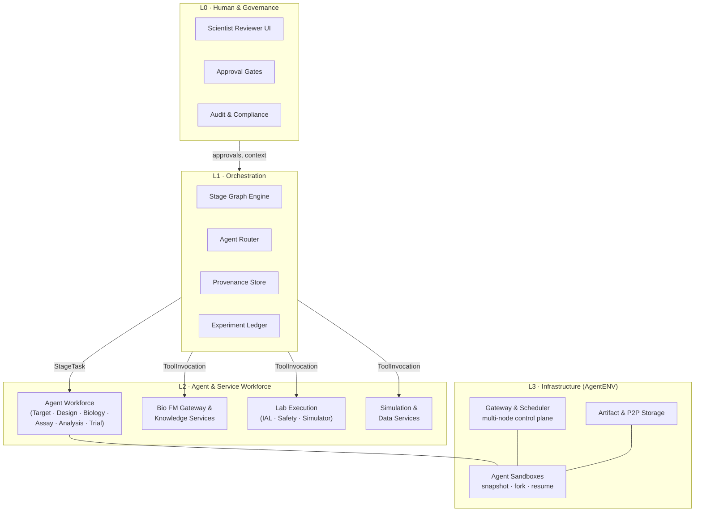

# Agentic Drug Discovery Platform

A multi-agent platform where specialized AI agents collaborate across drug discovery
stages — target identification, molecule design, in-silico screening, wet-lab assays,
and trial design — interacting with physical lab equipment through a safe hardware
abstraction layer.

This repository holds the **architecture definition**: diagrams, flows, stage
descriptions, and integration contracts. Each architectural block is designed to be
independently workable against a small set of shared contracts.

## Layered View

## Repository Layout

| Path | Contents |
|---|---|
| [`docs/architecture.md`](docs/architecture.md) | Architectural blocks A–F, components, responsibilities, interfaces |
| [`docs/flows.md`](docs/flows.md) | End-to-end flows: design iteration loop, fork/branch, review gates, wet-lab round trip |
| [`docs/blocks/`](docs/blocks/) | One deep-dive doc per block (A–F) |
| [`contracts/`](contracts/README.md) | The five shared integration contracts (StageTask, ToolInvocation, ProtocolSubmission, AssayResult, ProvenanceRecord) |
| [`diagrams/`](diagrams/) | Standalone Mermaid diagram sources |

## Architectural Blocks at a Glance

| Block | Name | Layer | Can start with |
|---|---|---|---|
| [A](docs/blocks/A-orchestration.md) | Workflow & Orchestration | L1 | stub tool endpoints |
| [B](docs/blocks/B-agents.md) | Agent Workforce | L2 | virtual lab + mocked models |
| [C](docs/blocks/C-models-knowledge.md) | Model & Knowledge Services | L2 | open-source FMs on a GPU box |
| [D](docs/blocks/D-lab-execution.md) | Lab Execution | L2/L3 | full virtual lab simulator |
| [E](docs/blocks/E-simulation-data.md) | Simulation & Data Services | L2 | existing MD/docking tools |
| [F](docs/blocks/F-infrastructure.md) | Infrastructure (AgentENV) | L3 | exists — integrate |

## Design Principles

1. **Contract-first integration** — blocks communicate only through five versioned
   schemas; nothing else couples them.
2. **Hardware behind an abstraction** — agents see the Instrument Abstraction Layer
   (IAL) only; a Virtual Lab Simulator is a drop-in stand-in for real robots.
3. **State is snapshot-able** — every experiment branch runs in a sandbox that can be
   forked, paused at review gates, and replayed for audits.
4. **Provenance is immutable** — every artifact carries full lineage (inputs, model
   versions, prompts, instrument run IDs) in WORM storage.
5. **Safety is non-bypassable** — a policy engine sits in the physical-action path,
   outside any agent's trust boundary.
