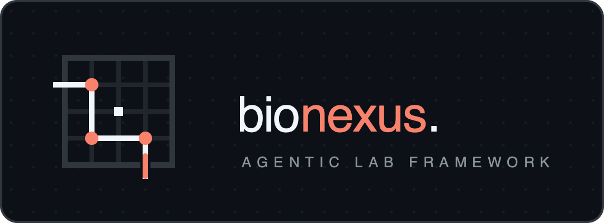
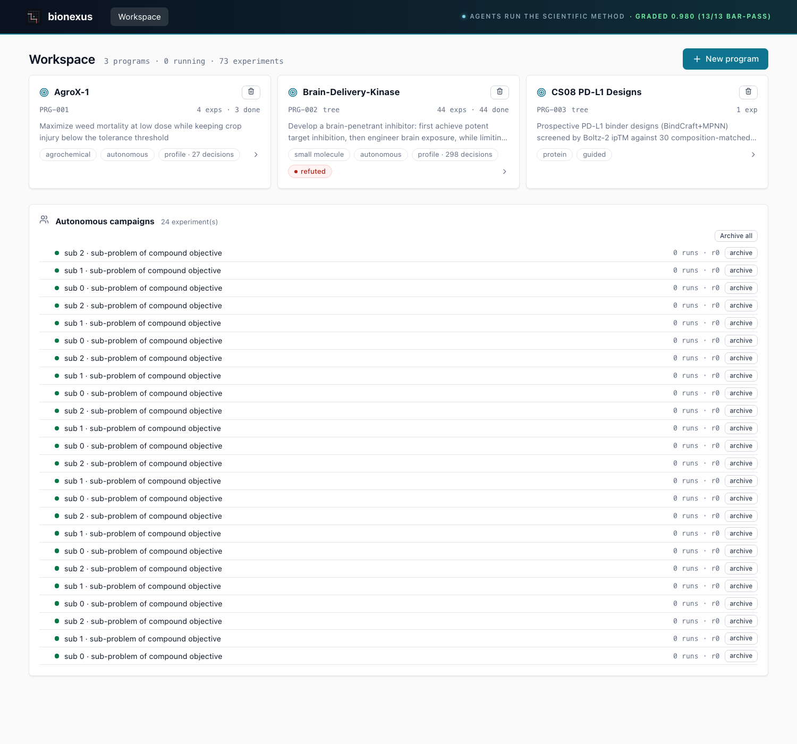
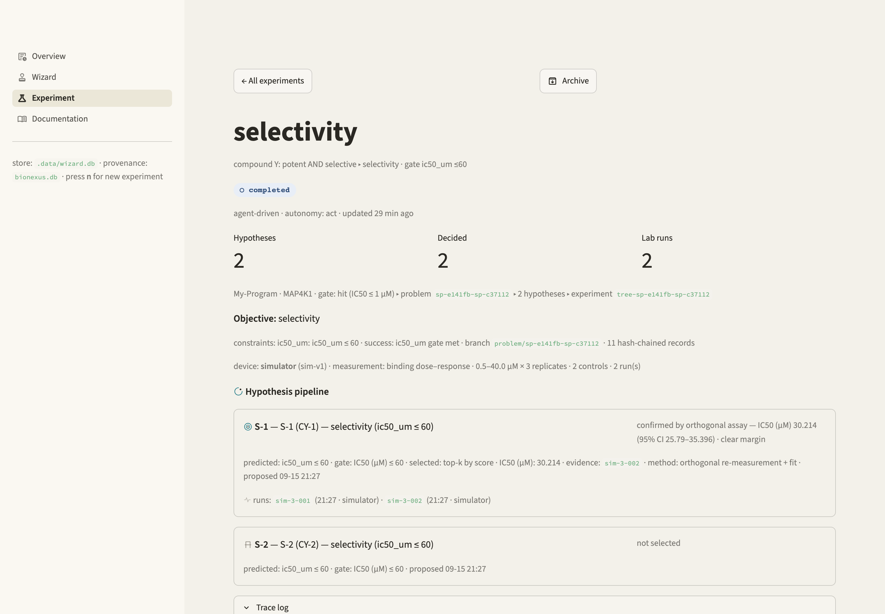

<p align="center">
  
</p>

[](https://github.com/rbalachandar/bionexus/actions/workflows/ci.yml)
[](https://pypi.org/project/bionexuslab/)
[](https://pypi.org/project/bionexuslab/)
[](LICENSE)

`bn demo` — a scripted campaign on the production machinery (simulated
numbers): a borderline CI abstains, an orthogonal method refutes a
plausible-looking hit, confirmation passes only on agreement, and the
whole run lands in a verified hash chain.


BioNexus is an open-source framework in which AI agents run the scientific
method end to end: given a research problem and its constraints, agents propose
a portfolio of hypotheses, select the ones worth testing, design experiments,
execute them on simulated or real laboratory equipment, observe the results as
they arrive, and deliver verdicts against criteria that were registered before
the experiment ran. A scientist can use it manually, step by step, as a daily
analysis tool — and hand stages of the loop to an agent as trust grows.

BioNexus is built on three principles:

- **Safety enforcement.** The only path from an agent to a lab is the
  gateway: every submission passes a policy engine the agent
  cannot modify or approve itself, and budgets cap what a campaign may
  consume. When experiments declare structures, those are screened against
  versioned toxicophore rules, so a declared covalent warhead can pass while
  an undeclared one does not. Campaigns that name a regulated pathogen or
  toxin are refused, and the refusal is recorded.
- **Tiered trust.** Deterministic rules hold the floor. A model may add a
  flag or demand a human review, but it can never clear a refusal. Humans
  settle the edge cases, and it is their judgment, not the model's
  confidence, that writes new rules. Citations are checked against PubMed: a
  hypothesis that cites a fake paper ranks below one that cites nothing.
- **Everything auditable.** The problem, the hypotheses, every decision,
  submission, result and verdict go into a hash-chained provenance store.
  One command renders the whole story as a report. Another seals it with a
  checksum you can publish somewhere you do not control, so anyone can check
  that the record has not been edited.

**Contents:** [Installation](#installation) · [CLI](#cli) ·
[Evals](#evaluation-suite) ·
[Case studies](#case-studies) ·
[Using BioNexus](#using-bionexus) · [The virtual lab](#the-virtual-lab) ·
[Five core interfaces](#five-core-interfaces) · [Agent Skills and MCP](#agent-skills-and-mcp) ·
[Architecture](#architecture) · [Documentation](#documentation) ·
[Design principles](#design-principles) · [References](#references--sources)

## Installation

```sh
pip install bionexuslab                 # core (pydantic only) + CLI
pip install "bionexuslab[dev]"          # + development dependencies
```

Optional extras: `[models-openai]` · `[bio-rdkit]` · `[lab-imaging]` ·
`[sandbox-agentenv]` · `[sandbox-opensandbox]` · `[store-postgres]`.

## CLI

Every capability is a `bn` command; the same functionality is available as a
Python API (see [Using BioNexus](#using-bionexus)).

```sh
 bn demo                                # first run: abstains on a borderline
                                        # CI and refutes a planted false hit (real
                                        # machinery, simulated numbers)
bn read results.csv --csv out.csv      # auto-analyze an instrument export
bn read plate.csv --layout map.csv \
        --normalize pct_inhibition     # join a plate map; %INH vs the plate's
                                       # own blank + full-inhibition controls
bn ingest legacy-eln.csv               # institutional memory: pre-BioNexus kills
                                       # enter ALREADY RULED OUT + family priors
bn connect scan <share>                # detect instruments writing into a folder
bn watch <outbox>                      # agent notices device outputs as they land
bn templates                           # campaign presets — no JSON needed
bn auto --template dose-response-screen --field compounds=C1,C2,C3
make api                               # web app on :8000 (API + SPA)
bn diary <branch>                      # campaign as a lab-notebook narrative
bn prove <branch> --html out.html      # tamper-evident provenance + shareable report
bn prove <branch> --eln out.csv        # ELN-ready export (Benchling/SISSYO-friendly)
bn anchor [--publish-cmd CMD]          # Merkle-root the store; publish the root
bn plan --objective "potent AND selective AND soluble" \
        --model anthropic --run-budget 20   # decompose into a guarded problem tree
bn reproduce <branch>                  # replay a recorded experiment, diff verdicts
bn sim                                 # reference design round on the virtual lab
bn run examples/workflow.yml           # tournament + assay on the configured lab
bn mcp                                 # MCP server: drive BioNexus from Claude/Cursor
bn new-adapter lab my_robot            # scaffold a tested LabAdapter
bn skills list                         # discovered Agent Skills (theirs and ours)
 bn eval --all                          # scored task suite + leaderboard
bn why char-ridge train.csv CCCCCO       # attribution panel: per-prediction drivers + caveats + applicability domain
bn eval --suite epistemics,models      # run tiers separately
bn anchor --verify                     # Merkle root: prove the whole store's state
bn fixtures verify <study-dir>         # byte-reproducible case-study data
bn connect describe <device>           # interview you into an agent-readable device card
 bn auto --dose-design adaptive ...     # Bayesian sequential dosing (typically 3 wells, not 4)
 bn halt --engage --reason "spill"      # operator stop-condition outside the agent's reach
bn halt --clear                        # only a human clears it
bn sop list                            # agent-proposed recurring procedures awaiting sign-off
bn sop approve <sop-id> --by "lab lead"  # sign-off turns a procedure into standing policy
```

## Case studies

The case studies exercise the flow on three kinds of data: blind
reproductions of published papers (CS01–03), re-analysis of deposited
screening data (CS04–06), and a published protein-display dataset (CS07).
CS08 generates a new dataset on rented GPU hardware — designs screened
against composition-matched controls, with the refutation conditions
registered before the scores existed.

| Study | Data | Result |
|---|---|---|
| [Case study 01](case-studies/01-egfr-blind-reproduction/) | Gazit et al., *J. Med. Chem.* 1989 — the original tyrphostins paper | Q1 hypothesis identified, **qualified**: a probe confirmed the model has prior exposure to this literature (recognition, not derivation). Q2 ranking vs published IC50s passed. |
| [Case study 02](case-studies/02-az3246-hpk1/) | AZ3246 HPK1 inhibitor, *J. Med. Chem.* 2025 — post-training-cutoff | **Contamination-free** (self-report + never-published-variant probes). Agent derived the pyrazine-carboxamide hypothesis from structures alone; its blinded ranking (ρ = +0.42) outperformed a Random Forest trained on other HPK1 measurements (ρ = +0.08). *Figures predate a training-pool pagination fix; re-run on frozen fixtures is queued in the roadmap.* |
| [Case study 03](case-studies/03-multi-paper/) | Multi-paper blind validation on recent ChEMBL studies | **Blind chemotype identification on 4/4 papers** (cores match the actual chemistry); contamination clean by self-report on 4/4, and the never-published-variant probe independently flagged **1 leakage-suspect** case the self-report missed. Flow integrity + budgets verified; scaffold leakage ~absent; no enrichment claim survives CIs + BH at n=31–67 — all reported as such |
| [Case study 04](case-studies/04-prospective-hit2lead/) | Prospective hit-to-lead on real published data — EGFR, 26,322 ChEMBL measurement rows, the seven successor drugs (gefitinib→osimertinib) blinded | Gated `act` campaigns ran on ReplayLab against published truths, no simulator support. **5 hit claims — all true actives; 6 kills — all correct; 2 left-censored abstentions on the two sub-350pM compounds** (the most potent molecules were deliberately not numbered); reviewer clean; 209 hash-chained records. The blinded surrogate independently ranked Michael-acceptor chemistry #1–6, and the safety gate made testing it cost a declared covalent mechanism — the full refuse→redesign→gate→confirm loop on real data. Running real data also caught four product bugs, each fixed with a regression test. |
| [Case study 05](case-studies/05-paper-pilot/) | The paper pilot — a proxy for the lab pilot: Jacobs et al., *J. Med. Chem.* 2013, the NIH MLPCN anti-SARS-CoV 3CLpro cascade, reproduced **from the lab's own deposited raw tables** (PubChem AIDs 1890/1879; 290,893 → 405 → 136 → 44) | **98.9% agreement on decisive verdicts, zero false actives** (32 TP / 54 TN / 0 FP vs the submitters' calls) — and 14 abstentions where our bootstrap CIs straddle the paper's own 10 µM gate (their point estimates 4.6–9.9 µM). The single disagreement is disclosed curve-and-all; 5 cross-plate inconsistencies found in *their own* cascade (secondary vs their confirmatory curves). The deposit had real formatting defects (the REST header truncates the dose columns; the meta rows carry the truth) — `bn read` now parses PubChem deposits natively, structurally blind to the answer keys |
| [Case study 06](case-studies/06-ncats-deposit/) | The deposit pilot — a modern NCATS qHTS (AID 2061307, deposited 2025-09-13): 2,427 ALDH3A1 reassay curves vs NCATS' own AI-fit ACTIVE/INACTIVE/INCONCLUSIVE calls | **Negative result.** Fixed-reference 50%-crossing + CI rules do not port to internally self-normalized qHTS dialects (ρ = 0.107 vs their fits; 216 of their Inactives pass our trend filter). The pilot surfaced issues simulators do not produce: self-normalized baselines, autofluorescence flatlines needing curve-class rejection rather than threshold rejection, and a degenerate-fit trap (a known-max Hill fits a flat line as infinitely potent — detected by crosstab plausibility, not by tuning). Parser dialects + polarity refusals shipped with tests; answer keys untouched until verdicts locked |
| [Case study 07](case-studies/07-proteinbase/) | Reproduction of the Proteinbase paper (40 MB deposit, 5,253 proteins / 2,630 measured display pairs) — hit rates, selection replay, applicability-domain transfer | 98% agreement reproducing their measured hit rates from raw deposit; **two negative results**: selection policies replay at/below baseline on their tested pairs (consistent with CS08), and an AD floor built on their data false-alarms 84% in-domain — a calibration problem on real distributions |
| [Case study 08](case-studies/08-proteinbase-entry/) | Binder-design competition trial (Proteinbase/Adaptyv entry): 82 BindCraft PD-L1 designs generated and screened with Boltz-2 on rented GPU hardware (~$5), plus 30 composition-matched controls (scrambles of the top designs + random peptides) — newly generated data with no published source — all 112 through the hypothesis loop | **Boltz-2 ipTM separates designs from controls at the distribution level (MWU p≈1e-4, bootstrap CI [+0.12, +0.30]) but does not rank individual sequences**: AUC 0.80; the best composition-matched scramble scores 0.937, above 89% of real designs (73/82), and 11/30 controls clear the 0.7 gate — supporting use as a gate, not as a ranking. The pipeline ran end to end without an LLM API key. All 112 are hash-chained hypotheses with pre-registered refutation conditions; for the 11 validating controls, their own clause ("if this validates, ipTM's ranking value is refuted") is recorded as fired. In the workbench: `seed_workbench.py` → program card "CS08 PD-L1 Designs", verdict `partial`, 2 batched runs, origin-labeled cards |

Each case-study README documents its own limitations explicitly (e.g. CS04's
potency-only view misses osimertinib's real T790M-selectivity win).

## Evaluation suite

`bn eval` runs scored tasks against seeded ground truth — deterministic,
offline, in CI. Scores below 1.0 are kept as reported: an honest abstention
is graded down rather than counted as a pass. Example run:

```
epistemics — mean 0.982 · 14/14 tasks pass
  hit-recovery         0.917  honest abstains credited 0.5, not 1.0
  adaptive-dose        0.875  3 wells beat 4 — a genuine negative result
  applicability-domain 1.000  far chemistry stamped extrapolation —
                      confident claims vetoed in BOTH directions
  sandbox-isolation    1.000  sibling writes invisible, forks diverge,
                      lifecycle sealed, degradation loud
  verdict-honesty      1.000  must abstain where the CI straddles the gate
```

Full run: [`evals/leaderboard.md`](evals/leaderboard.md).

| Tier | Covers | Tasks |
|---|---|---|
| **epistemics** | scientific reasoning under uncertainty | hit-recovery vs truth · verdict-honesty (abstains where the CI straddles) · confirmation-coverage · falsifiability-tiebreak · adaptive-dose-design · flywheel-memory |
| **models** | baseline quality | policy ladder on MoleculeNet (Lipophilicity, ESOL, HIV) plus TDC ADMET Group (Caco2, HIA, BBB) on canonical scaffold folds — frozen in-repo, no network; vs the random floor. Fold-relative sanity (small held-out folds swing AUC; these are not leaderboard claims), scaffold-split throughout |
| **reproductions** | published-paper reruns | the blind paper studies (opt-in; frozen data fixtures) |
| **agent** *(opt-in)* | end-to-end loop triage | DDB-shaped workflows with ONE verifiable answer — exact refusal map (safety + makeability gates), zero refused-compounds-tested, zero wrong-confirms vs seeded truth, and byte-exact reruns — all graded deterministically, no LLM judge (`bn eval --suite agent`) |

Findings the suite produced during development: an observed-max fit bias,
per-run ground-truth instability, confirmation labels that overrode the
gate, and non-hermetic tests — all fixed, with the tasks kept as regression
tests. `evals/leaderboard.md` is regenerated on every run; the CI job
fails if any score drops below the pass bar.

The opt-in **agent tier** grades multi-step early-discovery workflows that
resolve to a single verifiable answer, deterministically and without an LLM
judge. Its first full run found a real ordering flaw: a batch was being
synthesized for a compound the toxicophore screen would refuse moments
later (Make ran before the submission screen). The fix shipped the same
day, with the tier's waste counter as the permanent regression test.

The `GET /api/evals` read-model serves these scores and flags every passing
task below 1.0 as an `honest_deduction`; the workbench header carries the
live `graded 0.954 · 24 tasks, all pass` badge on every page.

### Trust mechanisms

The mechanisms are modality-agnostic — the loop, the gates, and the record
work the same for a kinase IC50, a plate-reader export, or a protein
binder's predicted interface confidence. Some rows are one modality's
*implementation* of a general rule.

| Mechanism | What it guarantees |
|---|---|
| Uncertainty vetoes certainty | a 95% CI straddling the gate abstains on any metric — IC50, %-inhibition, ipTM alike; near-gate point estimates do not earn a decisive verdict (CS05: 14 abstentions; CS08: 6) |
| Pre-registered claims | every hypothesis records its predicted and **refuted-if** clauses before data arrives; verdicts are read against the pre-registered condition — CS08's control clauses ("if this validates, the score's ranking value is refuted") evaluated true, in the chain |
| Proxy-evidence ladder | every metric declares what it stands for; verdicts carry their evidence distance (`bn why`), and chains that do not reach the target claim (`ipTM → binding affinity`) are labeled unresolved |
| Provenance physics | the hash chain is engine-enforced and recomputed on read (`verify_chain`); verdict reading is payload-driven, recency-wins — the read path is verified like the write path |
| Molecular safety gate | 18+ curated toxicophore SMARTS (versioned data file — refusals cite the rule version); hard classes always refuse; electrophilic warheads pass **only** with declared covalent intent in the hypothesis |
| Execution governance | enforced in gateway code, outside the agent's tool surface: an operator halt switch it cannot lift (`bn halt`), a three-column authorization matrix (autonomous / human-approved / never — DURC and BSL-3+ default to never), and SOP sign-off before anything recurring runs unattended; every decision is a provenance record |
| Physical-fault honesty | saturated plates, dark reads, negative values, and device errors are classified as **physical** failures before any retry — flagged for operator inspection, not re-queried blindly and not turned into verdicts |
| DURC screening | campaigns naming select agents / regulated toxins are refused before any work, and the refusal is recorded |
| Citation enforcement | PMIDs/DOIs resolved against PubMed; a fabricated reference ranks below no citation at all; offline checks never falsely accuse |
| Makeability is a gate | before Make allocates a batch, a named-reaction rule corpus plans routes (how many, how long, at what cost, modeled yield); a compound whose routes all fail the yield/lead-time floors is refused with a `no_viable_route` provenance record — batch numbers are drawn from the chosen route and every plan is stamped simulated |
| Series discipline | proposed→tested→judged grouped by family or Murcko chemotype (grouping backend stamped); matched-pair SAR deltas carry propagated CIs and abstain when straddling the retention band; a series claim's verdict is derived only from its members and cannot aggregate past what its data supports |
| Institutional memory | `bn ingest` folds pre-BioNexus ELN outcomes into ALREADY RULED OUT and family priors — stamped `imported`, sha256-sealed against the export sidecar; a CSV edited after export imports as unsealed, with a warning |
| `bn reproduce` | the execution environment (lab, version, seed, concentrations) is in the provenance root — replay a branch, diff verdicts |
| Fault tolerance | junk/adversarial instrument files degrade to "unreadable, no verdicts changed" — no crashes, no verdicts from noise |
| Input trust boundary | instrument labels are sanitized data; injection-shaped sample names cannot reach the gate as instructions (tested) |
| Verdict stability | same ground truth, N noise draws — verdicts that flip are flagged borderline, not averaged away |
| Attribution | per-prediction "why": exact n-gram contributions, importance-weighted RF bits (with hashed-bit caveats stated), triggered ADMET rules, AVI feature attributions |
| Retrieval traces | every generation records prompt hash, model, injected flywheel negatives — "what shaped this hypothesis" is answerable from the chain |
| Anchoring | Merkle root over the whole store; publish it anywhere you don't control for external tamper-evidence |
| Evidence is the data | the Evidence section re-renders each branch's **recorded run files** — plate exports or model-prediction artifacts, the same numbers the verdicts were read from; a missing file renders as an explicit gap, not a stock figure |
| Retirement, not deletion | archived experiments leave the working set but their hash-chained records stay intact and auditable — consistent with the append-only provenance store |
| Regime-gated assertions | deposited percent tables are fingerprinted for their normalization frame; absolute IC50 verdicts issue only in externally validated frames (CS05), while self-normalized dialects (where CS06 showed numbers do not port) are admitted at the *shape* level only — affine-invariant concentration-dependence classes, labeled responders-never-verdicts (97.4% concordance with NCATS' own actives on their deposit). Trust is a declared envelope |
| Applicability domain | every learned predictor carries a nearest-neighbour Tanimoto domain (Morgan bits, char-gram fallback, declared conservative floor): values from beyond a model's training chemistry are stamped `extrapolation`, earn no claim-grade verdict in either direction, and are surfaced on the card — the model-side counterpart of the regime gate, graded by its own eval task |

## Using BioNexus

BioNexus supports two working styles, backed by the same engine and the same
five interfaces. The loop itself is **modality-agnostic**: the program defines
the objective in your own terms (any metric, unit, direction), the Make step
words production per modality (chemical synthesis, bioprocessing, engineered
cells), Test adapters supply the assay, and Analyze reads the registered
metric against its gate — small-molecule, biologic, agrochemical, or
materials programs differ in adapters, not in the framework.

### As a daily analysis tool — reading lab instrument exports

Point `bn read` at a plate-reader export. Long CSV/TSV/XLSX (any column
order, any vendor header block), plate grids, **kinetic tables**
(Tecan i-control, BioTek KC1/Gen5: time-rows × well-columns, with vendor
quirks tolerated — Windows-1252 encoding, `?????` placeholders for missing
values, multi-channel kept separate), and `.npy` images — all auto-detected.
IC50 fits carry CIs; Z′ is computed only when the plate has both control
classes (otherwise reported as `Z'~`, control-spread heuristic);
reader/device/serial/date are scraped into the result for provenance.
Format detection, control discovery, and QC are automatic:

```sh
bn read .data/exports/synergy_export_export.csv     # the virtual-lab export (from `bn demo`)
# plate: synergy_export_export.csv [long] | wells: 10 | controls: 2 | Z'~ 0.956 (control-spread heuristic)
# compound        IC50 (uM)  points  note
# C-101               10.52       4  observed-max
# C-102                4.77       4  observed-max

bn read tests/data/instruments/biotek_1steptimer.csv
# plate: biotek_1steptimer.csv [kinetic] | wells: 1536 | ... | reader: Synergy HTX (2206293D)
# (a bare grid: no compound identity, no concentration series — reported as such)

bn read tests/data/instruments/tecan_ON1.csv --layout tests/data/instruments/plate_layout_96.csv
# plate: tecan_ON1.csv [kinetic] | wells: 192 | ... | edge-effect -0.0 (OD600:600)
# joins well -> sample/concentration from the plate map, fits what it can

bn read tests/data/instruments/tecan_ON1.csv --normalize pct_inhibition
# bn: error: cannot normalize to %inhibition: need >=2 blank AND >=2
# full-inhibition control wells — raw values kept
# (the refusal path: this plate has no control-class wells)
```

A bare grid carries no compound identity — `--layout` joins a plate map
(well → sample/concentration, multi-layer conc/sample/reagent maps
supported) so exports without compound identity can still be fitted;
`--normalize pct_inhibition` rescales against the plate's own blank +
full-inhibition controls and refuses when those classes are missing.
The repo ships three genuine vendor exports (Tecan i-control CSV+XLSX,
BioTek 1-Step-Timer, Gen5 multi-channel) plus a plate map under
`tests/data/instruments/` (attributed, MIT) so the parser can be tried on
real vendor output before your own.

```python
from bionexus.labread import read_plate
r = read_plate("my_results.csv")   # long/grid/xlsx/imaging evidence
print(r)                           # IC50 table + Z' — no configuration
svg = r.curve_svg("C-101")         # fitted dose–response curve
```

Response is a fitted dose–response curve like this one (auto-generated
from a virtual-lab run):


### Solving a problem

```sh
bn sim                                    # reference round on the virtual lab
python examples/iteration_loop.py         # the same, step by step (see notebooks/)
```

A round runs: hypothesis tournament → safety-gated protocol → virtual wet lab →
analysis → provenance. Every stage can also be driven from Python with the five
core interfaces .

### Autonomous — hand the loop to the agent

To start the full flow without writing JSON, use a preset template:

```sh
bn templates                                    # list presets
bn auto --template dose-response-screen \
      --field compounds=C1,C2,C3                # fills in the problem for you
```

Or with your own config:

```sh
bn auto campaign.json
```

<details><summary>campaign.json — an example problem statement</summary>

```json
{
  "problem": {
    "objective": "Find a confirmed sub-20uM KRAS_G12C binder",
    "constraints": [
      {"name": "potency", "description": "IC50 <= 20 uM", "kind": "hard",
       "limit": 20.0, "unit": "uM"}
    ],
    "success_metric": "orthogonal confirmation"
  },
  "hypotheses": [
    {"statement": "C-101 binds with IC50 <= 20 uM", "candidate": "C-101",
     "assay_type": "binding", "predicted": "IC50 <= 20",
     "predicted_value": 20.0, "rationale": "covalent warhead precedent"}
  ],
  "autonomy": "act"
}
```
</details>

```
[campaign] problem prob-89fd555d: 3 hypotheses -> 2 selected
[campaign] [agent] noticed device output: sim-1403a26c.csv — reading it
[campaign] [agent] hypothesis hyp-22911313 (C-102): VALIDATED (preliminary — pending orthogonal confirmation) — IC50 1.833 uM (95% CI 1.5–2.4) vs threshold 20.0
[campaign] [agent] loop closed: confirmation assay for C-102 auto-submitted (safety-approved)
[campaign] [agent] orthogonal confirmation for C-102: primary 1.83 vs secondary 2.10 µM (ratio 1.1x, CIs overlap) -> CONFIRMED
{
  "problem": "prob-89fd555d",
  "selected": ["C-101", "C-102"],
  "verdicts": {"C-101": "refuted", "C-102": "confirmed"}
}
```

### Device-aware — the agent notices results on its own

With `bn watch` monitoring an instrument outbox, there are no files to shuttle:
when a reader exports a result, the agent reads it, updates open hypotheses
against their pre-registered criteria, and recommends the next step. The same
event interface maps to instrument webhooks and lab queue callbacks.

To find out which instrument writes into a given folder:

```sh
bn connect scan /path/to/reader_share
# scanned 2 files in /path/to/reader_share
#   long   x1   e.g. synergy_export.csv
#   → device: plate reader (auto-exporting to this share)
```

### Choosing the level of agent automation

| autonomy | agent behavior |
|---|---|
| `observe` | reads, fits, recommends — submits nothing |
| `gate` | proposes everything; each lab submission waits for your Approve click in the workbench |
| `act` | autonomous within the SafetyEngine, including confirmation assays |

Round breadth is schedulable: `"k": [4, 2, 1]` screens wide in round 1,
then narrows as the flywheel discounts failed families (`"k": 2` keeps it
constant). The run budget still caps the total either way.

Verdicts are uncertainty-aware: a fitted IC50 whose 95% CI straddles the
threshold comes back `inconclusive` rather than a decisive verdict. An
orthogonal confirmation verifies the *direction* of the preliminary verdict —
agreement confirms hits, refutes non-hits, and disagreement on a claimed hit
refutes it. Campaigns may run `--dose-design adaptive`: a Bayesian posterior
picks each next concentration (measured: 3 adaptive wells beat a fixed
4-point series, ~4x lower error — scored by `bn eval`).

A `ResourceBudget` (max lab runs, hypotheses, confirmations, wall clock) is
enforced at submission and generation time. Every step — problem, hypotheses,
decisions, submissions, verdicts — lands in the hash-chained provenance store;
`bn prove <problem-id> --html report.html` renders it as a shareable audit.

### The scientist's workbench

| Problem workspace | An experiment's record |
|---|---|
|  |  |

- **`make api`** — the single web portal (React + FastAPI), all local, no
  accounts, no cloud.
  - **Workspace — program cards.** Each program shows its verdict
    (`achieved / partial / no-tree`), computed from its pre-registered
    claims, its launched problem trees with per-node roll-up status and
    run budget, experiment rows with verdict tallies and run counts, and
    taste lines distilled from its own portfolio decisions.
  - **Experiment pages** (deep-linkable: `/programs/<slug>`,
    `/experiments/<eid>`, lineage breadcrumb). DMTA funnel, a round table of
    what was TESTED, and one hypothesis card per candidate: state badge,
    observed value **with its 95% CI drawn against the gate** (a straddling
    CI shows *inconclusive*, margin label included), **origin** (what the
    molecule actually is), the `predicted_by` model stamp, mechanism, and
    the pre-registered **refuted-if** clause.
  - **The record.** Hash-chained provenance; a sandbox receipt when the
    experiment ran in one (adapter, id, egress/memory policy, sealed op
    count); evidence curves re-rendered
    from recorded run files (or an explicit "none recorded" state); reviewer audit; trust section; raw trace log. Harness
    decisions the code made (halts, authorization column, SOP sign-offs,
    physical-fault classification) all surface here. Wizard experiments are
    provenance-chained too — `bn prove wizard/<id>`. Experiments are
    archived (retired from the working set, provenance intact), never
    silently deleted.
  - **Series view.** Proposed→tested→judged grouped by family or chemotype,
    per-series rollups, and a matched-pair SAR table whose calls carry CIs —
    straddling intervals abstain, and derived series claims show their
    status chip.
  - **Real data to click through:** `bn demo` seeds the abstain-and-refute
    cascade; `case-studies/08-proteinbase-entry/seed_workbench.py` seeds the
    prospective PD-L1 design campaign (112 hypotheses, 30 of them controls
    whose pre-registered refutation clauses evaluated true against the
    score's own ranking utility).
- **`bn serve`** — a headless alternative cockpit (stdlib HTTP, no
  dependencies) for approval queues and diaries on machines without a
  browser; useful for remote/headless boxes.
- **`bn diary <branch>`** — the hash-chained record as a static lab-notebook
  HTML file: hypotheses with rationale, tests with evidence runs, verdicts
  with predicted-vs-observed, gate decisions.
- **`bn read --csv out.csv`** — standardized results ready for Excel/GraphPad.

### The DMTA cycle — scientific decision layer

BioNexus structures the Design-Make-Test-Analyze cycle as first-class objects:

- **Target Product Profile (TPP)** — the workbench program defines winning
  in your own terms (objective, metric, unit, direction, gate — see the
  Program hierarchy below); for small-molecule programs, phased criteria
  (hit → lead → candidate → clinical) are available in the engine
  (`bionexus.tpp`) and evaluated after every experiment
- **Experiment Definition** — the full scientific manifest: intervention,
  biological system, delivery conditions, readout capabilities, denominators,
  and expected intermediates (not just protocol steps)
- **Readiness Review** — runs *before* the safety gate: checks that the
  experiment, if successful, would produce an interpretable result (denominators
  present, authentic modification distinguishable, delivery variance controlled,
  synthesis feasible)
- **Program hierarchy** — Program ▸ Problem ▸ Hypothesis ▸ Experiment: you
  define the problem in your own terms — objective in plain words, any
  metric, unit, and direction (`pathogenicity_score ≥ 0.8`, `fold_change`
  `≤ 2`, IC50 in µM — anything). That gate is what wizard hypotheses and
  agent experiments inherit
- **Flywheel** — every verdict is remembered: mechanistic families that fail
  are discounted in later portfolios, and the hypothesis agent is shown what
  the lab already ruled out

```python
from bionexus.tpp import standard_small_molecule_tpp, CriterionPhase
from bionexus.experiment import (ExperimentDefinition, ClaimType,
                                 Intervention, ReadoutSpec)
from bionexus.readiness import review_experiment

tpp = standard_small_molecule_tpp("Program-X", "MAP4K1")
exp = ExperimentDefinition(
    scientific_question="Does S62 phosphorylation cause degradation?",
    claim_type=ClaimType.causal_modification,
    intervention=Intervention(kind="protein_edit", target="c-Myc", site="S62"),
    readout=ReadoutSpec(assay="ratiometric MS", measures_edited_fraction=True),
    ...)
review = review_experiment(exp)
print(review.verdict)   # ready / ready_with_warnings / blocked
```

The readiness review can **block** an experiment before it runs — not because
it's unsafe, but because its result wouldn't be interpretable (missing
denominator, mimetic vs authentic modification, delivery variance unmeasured).

**External database adapters:** ChEMBL (dataset download), Open Targets
(GraphQL), PubMed (NCBI E-utilities) — for live database queries during
hypothesis generation and target validation.

**Benchmark datasets:** MoleculeNet (Lipophilicity, ESOL, BACE), TDC, DOCKSTRING
— see [`docs/benchmarks.md`](docs/benchmarks.md).

### Under the hood — how skills, tools, agents, and gates compose

When you run `bn auto`, here is what actually happens to one compound, step by
step, and which BioNexus layer is responsible at each point:

| Step | Who acts | What happens | What BioNexus enforces |
|---|---|---|---|
| 1. Problem setup | **Problem definition** | Decomposes the objective into constraints | Records problem + constraints as provenance root |
| 2. Hypothesis proposal | **Hypothesis agent** using the `rdkit` **skill** | Generates analogs with SAR rationale | Validates schema, dedupes, records rationale |
| 3. Portfolio filter | **Portfolio selector** | Scores + ranks, applies diversity cap | Records every accept/reject with reason |
| 4. Readiness review | **ExperimentDefinition** | Checks: is the readout capable? denominator present? synthesis feasible? | **Blocks** if result would be uninterpretable |
| 5. Safety gate | **SafetyEngine** | Checks reagents, BSL, step count, **toxicophores in sample structures**, dual-use text | **Refuses** with machine-readable reason + rule-set version |
| 5b. Governance gate | **HaltSwitch + AuthorizationMatrix + SOP registry** — code the agent cannot reach | Checks the operator halt, the autonomous/human/never column, and SOP sign-off for recurring work | Refuses outside the agent's reach; every decision recorded as provenance |
| 6. Lab execution | **LabAdapter** (simulator, Opentrons, PlateReaderShare) | Runs the assay, produces raw evidence | Records run ID, parameters, and raw output |
| 7. Device event | **DeviceMonitor** | Notices the export appeared | Triggers agent analysis automatically |
| 8. Analysis | **Analysis agent** + `labread` | Fits IC50s, checks QC, flags artifacts | Records measurements + QC flags as provenance |
| 9. Verdict | **Analysis** against pre-registered criteria | VALIDATED / INVALIDATED / INCONCLUSIVE | Records the verdict with evidence and criteria |
| 10. Audit | **ProvenanceStore** | Renders the full chain | `bn prove` verifies the hash chain |

The skills teach the agent *how* (domain knowledge from Scientific Agent Skills
or the `bionexus` skill). The tools let the agent *act* (`run_assay`,
`propose_hypothesis`, via MCP or direct Python). The gates decide *whether*
(SafetyEngine + readiness review). The provenance records *what happened*.
Each layer is independently swappable — but they only produce trustworthy
science when composed through the BioNexus flow.

### What BioNexus helps with

The intelligence comes from the models: the LLM derives the SAR hypothesis, the
QSAR model makes the calibrated prediction.
BioNexus is the layer that makes those results executable, bounded, measurable,
and auditable — the case studies above exercise this layer:

| Campaign step | What the model does | What BioNexus does |
|---|---|---|
| Problem setup | — | Records problem + constraints as the provenance root |
| Contamination control | — | Runs and records post-cutoff probes; the no-knowledge claim is part of the audit trail |
| Hypothesis generation | LLM proposes families + tuned variables | Constrains, validates, dedupes, records; injects skill guidance |
| Portfolio filter | LLM scores confidence | Enforces diversity caps; records every accept/reject reason |
| Experiment execution | — | Safety-gates the submission; the lab produces raw evidence |
| Result awareness | — | Device monitor notices the output automatically |
| Verdicts | LLM interprets | Scores against pre-registered criteria with **confidence intervals**: QC failure or CI straddling the threshold → inconclusive |
| Memory | LLM avoids dead ends when told | Flywheel: failed mechanistic families are discounted in every later portfolio |
| Accountability | — | Hash-chained provenance + Merkle anchoring; `bn prove` renders the audit, `bn anchor` makes it externally checkable |
| Measurement | — | `bn eval`: scored, deterministic task suite in CI — hit recovery, verdict honesty, confirmation coverage, falsifiability, adaptive design, flywheel memory |

## The virtual lab

BioNexus ships simulated devices so the entire loop runs offline, and so agent
behavior is testable before hardware is involved:

- **SimulatorLab** — seeded dose–response ground truth, replicates,
  counterscreen interference (PAINS-like artifacts), controls
- **Biologics readout simulators** — DLS (Brownian + scattering physics,
  polydisperse field-correlation sums), ELISA (4PL saturation curves),
  DSF (two-state Boltzmann melts): seeded synthetic instrument exports
  with known ground truth, roundtrip-tested against the analysis
  adapters — pipeline validation without physical machines
- **ImagingSimulatorLab** — a 96-well imaging plate reader: raw fluorescence
  micrographs per well, an analysis pipeline that fits IC50s from the images,
  Z'-factor QC, and per-well artifacts (pipetting spikes, bubbles, edge effects)
- **Recording/playback** — real hardware sessions are recorded once and replay
  identically in CI

With a multimodal model, the agent can even read the plate visually:
`demo_vision_readout.py` shows a vision-LLM estimating fluorescence from pixels
alone and recovering the IC50 to the same order of magnitude as the analysis
pipeline. See [`docs/virtual-lab.md`](docs/virtual-lab.md).

## Five core interfaces

Everything in BioNexus implements one of five interfaces; adapters are opt-in
and interchangeable. The contracts are the pydantic models in `bionexus.core.contracts`.

| Interface | Adapters (now → roadmap) |
|---|---|
| `ModelProvider` | openai_compat (OpenAI/ollama/vLLM/stub — Authorization header sent), anthropic → gemini |
| `LabAdapter` (+ `SafetyEngine`, `LabGateway`) | simulators: SimulatorLab, imaging, recording/playback, replay, bioprocess, synthesis, protein-design skeleton. Real-I/O: PlateReaderShare (share-watch + `labread`). Reference drivers, NOT hardware-validated (see ROADMAP S-T4): Opentrons OT-2/Flex (HTTP), generic-HTTP device template (not a SiLA 2 binding), HCS & LC-MS (simulator-only — live mode raises), arm scheduler (REST template) → cloud labs |
| `Sandbox` | local (copy-on-fork), docker (commit-based snapshots), OpenSandbox (gVisor/Kata/Firecracker runtimes, K8s scale, egress controls), AgentENV (VM-level snapshots) |
| `ProvenanceStore` | sqlite → postgres, s3-worm |
| `BioTool` | rdkit descriptors, ADMET, AlphaGenome Atlas variant scoring (AVI) → docking, ESMFold |

Sandbox execution is opt-in: campaign config `sandbox:
{mode: per_experiment, type: local|docker}` runs one sandbox per experiment —
lab submissions, statuses and results execute in-sandbox (tool calls route
through the same worker via `SandboxSession.registry()`), every op is
provenance-sealed, and the experiment page carries a receipt. Docker mode
uses the repo-installed image (`Dockerfile.sandbox`) with egress closed by
default, verified end to end in CI. The analysis fit and the
agent/reviewer/MCP registry lanes remain in-process (S-T3 1d/1e in
[`docs/ROADMAP.md`](docs/ROADMAP.md)).

## Agent Skills and MCP

BioNexus ships as an [Agent Skills](https://agentskills.io/) package
(`skills/`, `plugin.json`) and exposes its tools over MCP:

```json
{"bionexus": {"command": "bn", "args": ["mcp"]}}
```

It composes with [Scientific Agent Skills](https://github.com/K-Dense-AI/scientific-agent-skills):
those skills teach an agent *how* to author protocols and query databases;
BioNexus decides *whether they run*, and records what happened. Focused skills:
`bionexus` (overview) · `bionexus-labread` · `bionexus-labwatch` ·
`bionexus-campaign` · `bionexus-opentrons`.

## Architecture

Blueprint-style diagrams (SVG) of the engine architecture, blocks A–F.
Adapter and workbench details are documented in
[`docs/architecture.md`](docs/architecture.md) and the
Five-core-interfaces table above.

**1 · Layered View** — L0 governance → L3 infrastructure, with the five architectural blocks between.


**2 · Design Iteration Loop** — one active-learning round, from dossier to
next-round proposals. (In-silico assay stages shown are adapters: ADMET is
implemented; docking and MD are roadmap `BioTool` implementations.)


**3 · Hypothesis Tournament** — Generate → Reflect → Rank → Evolve, plus the fine-tuning flywheel.


**4 · Wet-Lab Round Trip** — protocol through the safety boundary, instruments, and back as provenance.


**5 · Fork / Snapshot Branching** — sandbox lifecycle as experiment tree.


**6 · Campaign Pipeline** — target ID through trial design with human gates and failure loops. ("FM-driven design" is the protein track: the simulator and the BindCraft/Boltz design loop of CS08; cloud-lab execution is the roadmap.)


**7 · Problem → Portfolio → Autonomous Loop** — state the problem, propose N hypotheses, filter to k, autonomous test-and-confirm with the provenance spine.


**8 · Scientific Decision Layer** — Experiment Definition and Readiness Review, between hypothesis and safety gate.


Styled HTML versions (light blueprint pages with legends/captions) live in
[`diagrams/artifacts/`](diagrams/artifacts/) — open locally in a browser.
Deeper design docs: [`docs/architecture.md`](docs/architecture.md) (blocks A–F),
[`docs/flows.md`](docs/flows.md) (end-to-end flows), [`docs/blocks/`](docs/blocks/).

## Documentation

| Doc | Contents |
|---|---|
| [`docs/QUICKSTART.md`](docs/QUICKSTART.md) | install, scientist path, workflows |
| [`docs/ADAPTERS.md`](docs/ADAPTERS.md) | authoring adapters (labs, models, tools, stores) |
| [`docs/SAFETY.md`](docs/SAFETY.md) | safety rules, LabGateway, audit trail |
| [`docs/security.md`](docs/security.md) | threat model, trust boundaries, agent capability matrix |
| [`docs/virtual-lab.md`](docs/virtual-lab.md) | simulated devices, image-based readouts, QC and failure modes |
| [`docs/benchmarks.md`](docs/benchmarks.md) | public datasets and benchmark results |
| [`docs/domain-review.md`](docs/domain-review.md) | flow fidelity review vs. the real drug-discovery cycle |
| [`docs/stability.md`](docs/stability.md) | versioning, stability tiers, deprecation policy |
| [`docs/research-landscape.md`](docs/research-landscape.md) | review vs. Google, Anthropic, Isomorphic, Cradle, Lila, FutureHouse, OpenAI Rosalind |
| [`docs/critical-review.md`](docs/critical-review.md) | independent critical review: strengths and failure modes |
| [`docs/PLAN.md`](docs/PLAN.md) | build plan, principles, guardrails |
| [`docs/ROADMAP.md`](docs/ROADMAP.md) | live TODO plan: uncertainty-aware verdicts, eval harness, adaptive design |
| [`docs/architecture.md`](docs/architecture.md) · [`docs/flows.md`](docs/flows.md) · [`docs/blocks/`](docs/blocks/) | architectural blocks A–F, components, interfaces, end-to-end flows |
| [`case-studies/`](case-studies/) | blind reproduction studies on real published data |
| [`diagrams/`](diagrams/) | SVG diagrams + styled HTML artifact pages |

## Design Principles

1. **Contract-first integration** — blocks communicate only through five versioned
   schemas; nothing else couples them.
2. **Hardware behind an abstraction** — agents see the Instrument Abstraction Layer
   (IAL) only; a Virtual Lab Simulator is a drop-in stand-in for real robots.
3. **State is snapshot-able** — every experiment branch runs in a sandbox that can be
   forked, paused at review gates, and replayed for audits.
4. **Provenance is immutable** — every artifact carries full lineage (inputs, model
   versions, prompts, instrument run IDs) in WORM storage.
5. **Safety is non-bypassable** — a policy engine sits in the physical-action path,
   outside any agent's trust boundary.
6. **Claims are measured** — every capability claim has a scored eval task behind
   it; uncertainty is reported, not rounded away.
7. **AI can only tighten the gate** — deterministic rules hold the safety floor,
   model judgment may add flags or demand review but never clear a refusal,
   and humans — not the model — promote adjudications into rules.

## Contributing

Start with [`docs/ADAPTERS.md`](docs/ADAPTERS.md) and
`bn new-adapter` — every adapter scaffold is born with a passing test.
Interface changes go through an ADR; see
[`docs/stability.md`](docs/stability.md). Apache-2.0.

## References & Sources

The architecture draws on published work from teams operating in this space. The
full review — what each system does, how it compares, and which learnings were
folded into this design — is in [`docs/research-landscape.md`](docs/research-landscape.md).

**Key sources:**

- Google — [AI co-scientist](https://research.google/blog/accelerating-scientific-breakthroughs-with-an-ai-co-scientist/) ([paper](https://arxiv.org/abs/2502.18864)) · [AlphaFold 3](https://www.nature.com/articles/s41586-024-07487-w) · [Isomorphic Labs Drug Design Engine](https://www.isomorphiclabs.com/articles/the-isomorphic-labs-drug-design-engine-unlocks-a-new-frontier) · [Bioresilience approach](https://www.isomorphiclabs.com/articles/our-approach-to-bioresilience)
- Anthropic — [Claude for Life Sciences](https://www.anthropic.com/news/claude-for-life-sciences) · [Model Hardware Standard](https://www.anthropic.com/news/model-hardware-standard-research-preview)
- Cradle Bio — [Platform](https://www.cradle.bio/platform) · [Series B / wet-lab expansion](https://techcrunch.com/2024/11/26/cradle-builds-out-its-protein-design-ai-platform-and-wet-lab-with-73m-in-new-funding/)
- FutureHouse — [Robin multi-agent system](https://www.futurehouse.org/research-announcements)
- Lila Sciences — [Agent-driven science on NVIDIA BioNeMo](https://www.lilasciences.com/news/building-the-agent-driven-era-of-science-with-nvidia-bionemo-agent-toolkit)
- Helical — [Virtual AI lab / Helix-mRNA FM](https://www.helical.bio/)
- Coscientist (CMU) — [Autonomous chemical research with LLMs + robotics, Nature 2023](https://www.nature.com/articles/s41586-023-06792-0)
- OpenAI + Retro Biosciences — [GPT-4b micro protein engineering, MIT Tech Review](https://www.technologyreview.com/2024/12/09/1108188/openai-model-for-protein-engineering-gpt-4b-micro-retro-biosciences/)
- Chai Discovery — [chai-1/chai-2 structure & antibody models](https://www.chaidiscovery.com/)
- OpenSandbox — [production sandbox runtime](https://github.com/opensandbox-group/OpenSandbox) — supported Sandbox adapter target (gVisor/Kata/Firecracker, egress control, K8s)
- Scientific Agent Skills (K-Dense) — [163 validated scientific agent skills](https://github.com/K-Dense-AI/scientific-agent-skills) — complementary knowledge layer; BioNexus tools are exposed via MCP and the Agent Skills standard
- OpenAI — [GPT-Rosalind & Rosalind Workbench](https://openai.com/gpt-rosalind/) ([announcement](https://developers.openai.com/blog/rosalind-workbench)) — closed vertical competitor; see [positioning analysis](docs/research-landscape.md#rosalind-what-it-changes-and-where-bionexus-stands)
