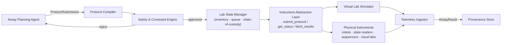

# Architecture

## Layers

| Layer | Purpose | Blocks |
|---|---|---|
| L0 | Human & Governance | reviewer UI, approval gates, audit |
| L1 | Orchestration | stage graph, agent routing, provenance, ledger |
| L2 | Agent & Service Workforce | agents, models, lab execution, simulation |
| L3 | Infrastructure | AgentENV sandboxes, control plane, storage |

## Block A — Workflow & Orchestration (L1)

*Independently buildable: pure software, no hardware/model deps.*

| Component | Responsibility |
|---|---|
| **Stage Graph Engine** | Declarative DAG pipeline: Target ID → Hit Generation → Lead Optimization → Preclinical → Trial Design. Retry, branching, parallel fan-out |
| **Agent Router** | Capability matching, assignment, load balancing of stages to agent instances |
| **Human-in-the-Loop Gates** | Pause/resume points for scientist approval/redirect (maps to AgentENV sandbox pause/resume) |
| **Provenance Store** | Immutable lineage for every artifact: inputs, model versions, prompts, lab run IDs (WORM) |
| **Experiment Ledger** | In-flight experiment state: instrument claims, pending results, cost tracking |

**Interfaces out:** `StageTask` → agents; `ToolInvocation` → blocks B/C/D/E.

## Block B — Agent Workforce (L2)

*Independently buildable: sandbox-resident processes with the tool API contract.*

| Agent | Role | Consumes | Produces |
|---|---|---|---|
| **Target Research Agent** | Disease biology analysis, target selection & triage | publications, omics DBs | target dossiers |
| **Design Agent (Chemist)** | Generative/structure-based molecule design | target structures, property feedback | molecule candidates + rationale |
| **Biology Agent** | Protein/antibody/therapeutic design | protein FMs, sequences | biologic candidates |
| **Assay Planning Agent** | Candidates → executable wet-lab protocols | candidate library, lab capability catalog | protocols |
| **Analysis Agent** | Interprets results, drives active learning loop | assay results, trial data | findings + next-round proposals |
| **Trial Design Agent** | Patient stratification, endpoints, protocol simulation | historical trial data, population models | trial protocols & simulations |

Every agent runs in an **AgentENV sandbox**: forked per experiment branch, snapshotted
at review gates.

## Block C — Model & Knowledge Services (L2)

*Independently buildable: inference/gateway services behind a tool API.*

| Component | Purpose |
|---|---|
| **Bio FM Gateway** | One versioned inference API: protein structure, property prediction, generative chemistry, ADMET |
| **Knowledge Base Service** | Literature RAG, patents, pathways, internal experiment history |
| **Molecule/Sequence Registry** | Canonical candidate store with computed properties, similarity indexes |
| **Evaluation Harness** | Benchmark suites (docking, retrosynthesis, ADMET panels) run on every candidate batch |

## Block D — Lab Execution (L2/L3 boundary)

*Independently buildable behind the IAL contract.*

| Component | Responsibility |
|---|---|
| **Instrument Abstraction Layer (IAL)** | Uniform API over heterogeneous instruments/cloud labs |
| **Protocol Compiler** | Abstract protocol → instrument-specific scripts; capability validation |
| **Safety & Constraint Engine** | Hard policy blocks outside agent trust boundary: reagent limits, biosafety levels, forbidden combos |
| **Lab State Manager** | Inventory, scheduling queue, sample tracking / chain of custody |
| **Telemetry Ingestor** | Raw instrument output → normalized `AssayResult` → Provenance Store |
| **Virtual Lab Simulator** | Mock instruments + assay outcome simulation — zero-change swap to real hardware |

## Block E — Simulation & Data Services (L2)

*Independently buildable: computational assays substituting/complementing wet-lab.*

- Molecular dynamics / docking farm (GPU batch)
- In-silico assay simulation (backs the Virtual Lab Simulator)
- Clinical trial simulation (population, dropout, adverse-event models)
- Data platform: ELN/LIMS integration, assay QC, feature stores for active learning

## Block F — Infrastructure (AgentENV, L3)

*Exists; integration work only.*

- **AgentENV server per node**: E2B-compatible sandboxes hosting agents; snapshot/fork
  enables experiment branching and review-gate state capture
- **Gateway + Scheduler**: multi-node scale-out, sandbox-to-node routing
- **Artifact storage**: agent rootfs layers pre-loaded with tools (RDKit, BioPython,
  FM clients); P2P artifact transport for large files (structures, trajectories)
- **Custom extension hooks**: natural insertion point for lab callbacks (e.g., stop
  hook checkpoints agent state when a batch completes)

## Design Principles

1. **Contract-first integration** — five schemas couple the platform, nothing else.
2. **Hardware behind an abstraction** — Virtual Lab Simulator is a drop-in IAL peer.
3. **State is snapshot-able** — fork/pause/resume/replay at every gate.
4. **Provenance is immutable** — full lineage in WORM storage.
5. **Safety is non-bypassable** — policy engine in the physical-action path.
