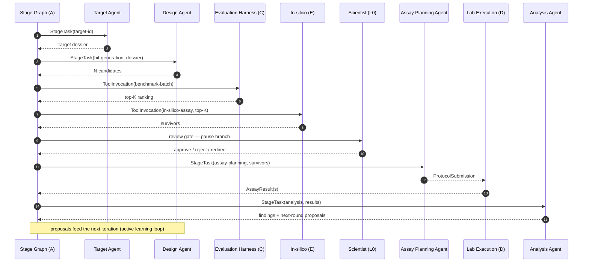
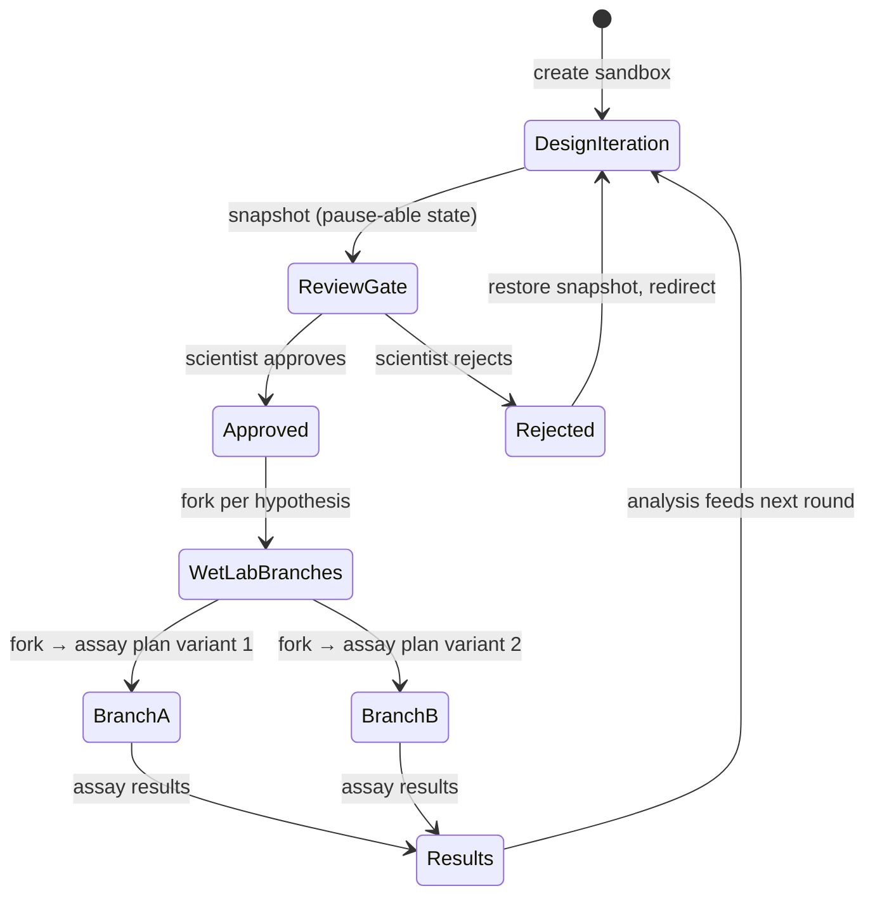
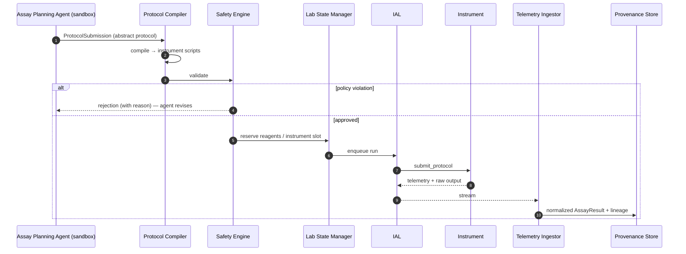
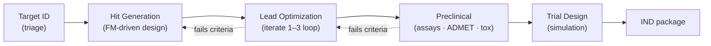
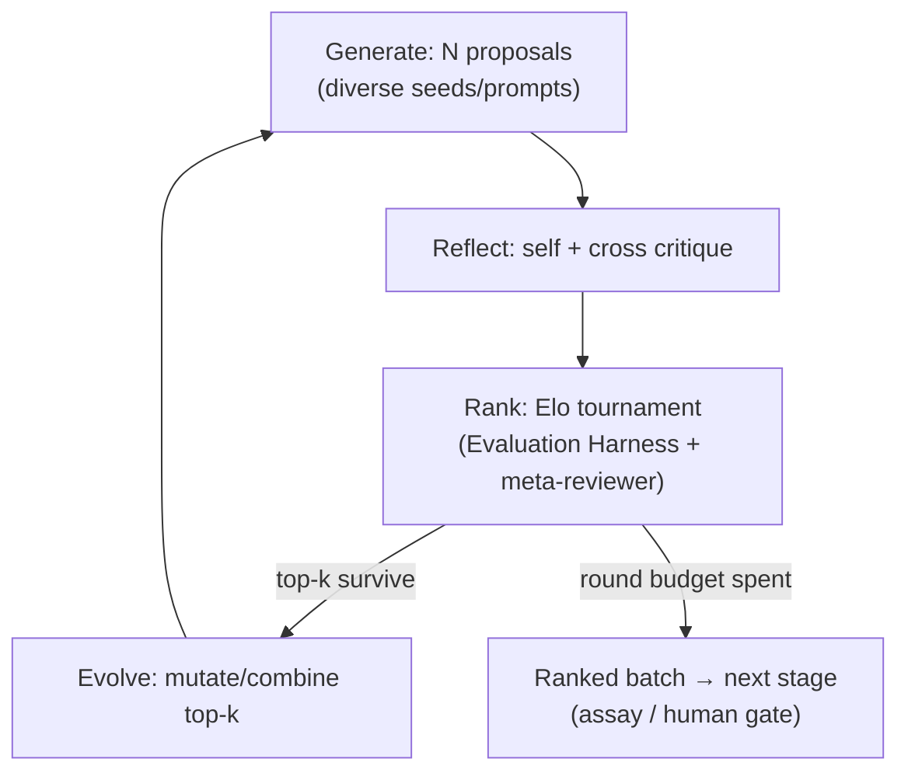
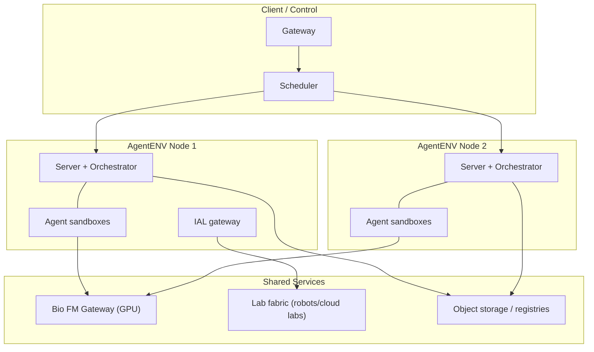
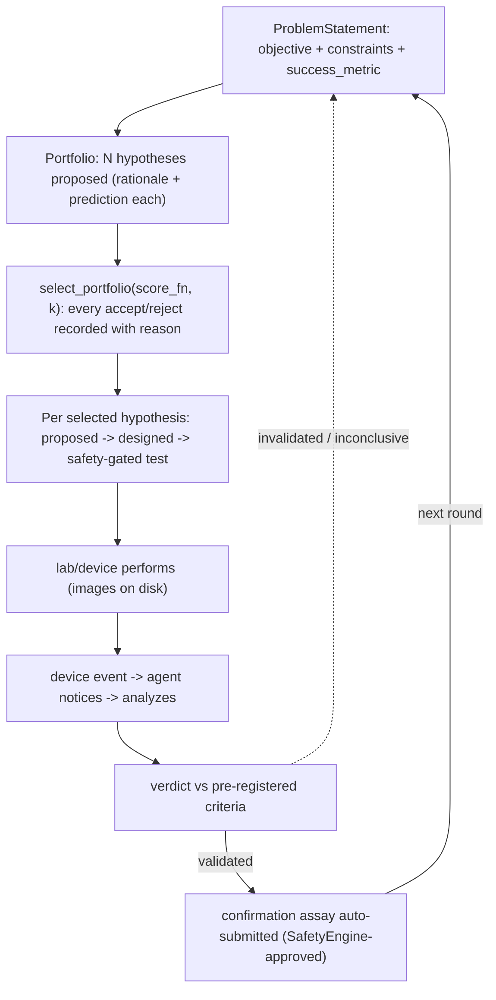

# Flows

## 1. Design Iteration Loop (primary flow)

Every hop appends a `ProvenanceRecord`.

## 2. Sandbox Branching with Fork / Snapshot

AgentENV's fork/snapshot maps experiment tree structure onto sandbox lifecycle:

- **Fork** at the wet-lab step runs parallel assay hypotheses in isolated sandboxes.
- **Snapshot** at review gates means any branch can be resumed or replayed for audits
  (the full agent state — prompts, tools, context — is captured, not just outputs).

## 3. Wet-Lab Round Trip (hardware in the loop)

Against the **Virtual Lab Simulator**, this identical flow runs with simulated
instruments — agents never know the difference.

## 4. Stage Pipeline (campaign view)

Each pipeline stage maps to a Stage Graph sub-DAG that runs the iteration loop
(flow 1) until stage-exit criteria are met or a human intervenes. Within each design
round, candidate generation runs as a **hypothesis tournament** (Generate → Reflect →
Rank → Evolve; see `docs/blocks/B-agents.md`) rather than a single pass — the pattern
validated by Google's AI co-scientist. Confirmed wet-lab results also feed the
**fine-tuning flywheel** in Block C, so each round's models are better than the last.

## 5. Hypothesis Tournament (inside one design round)

## 6. Deployment View

## 7. Problem → Portfolio → Autonomous Loop (the full flow, as implemented)

